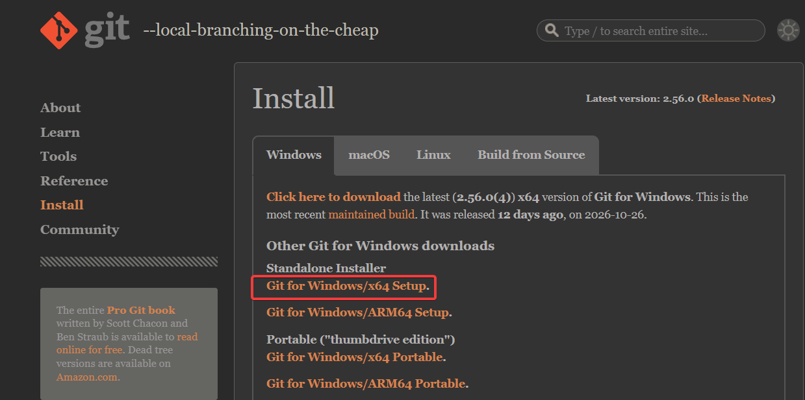
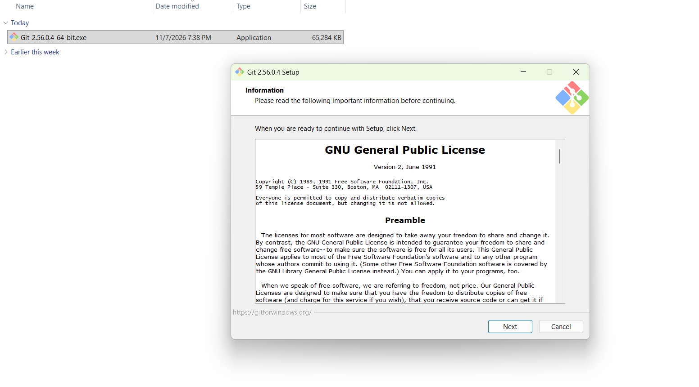
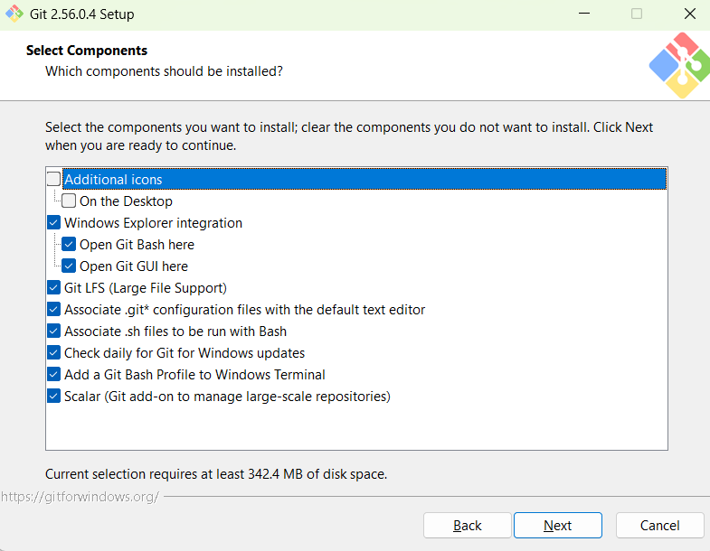
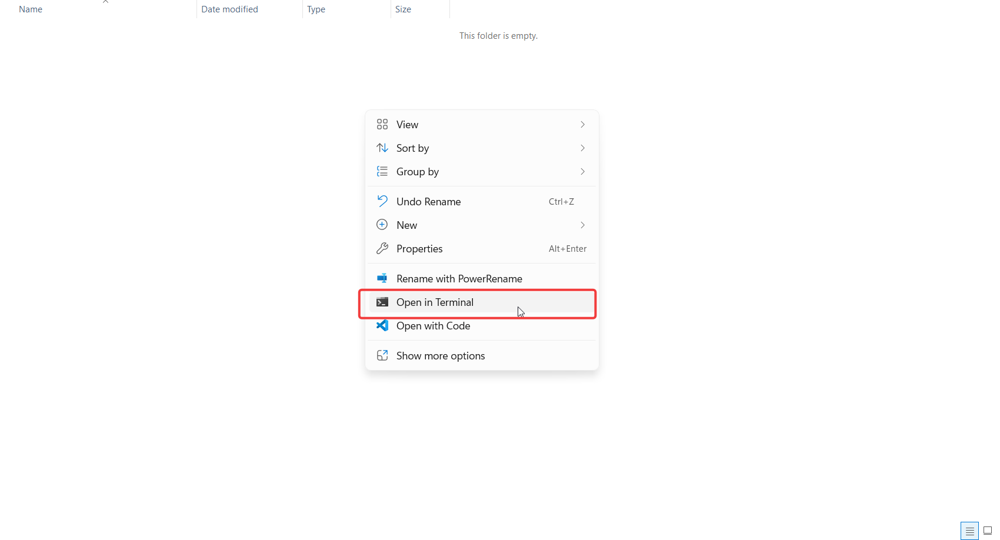
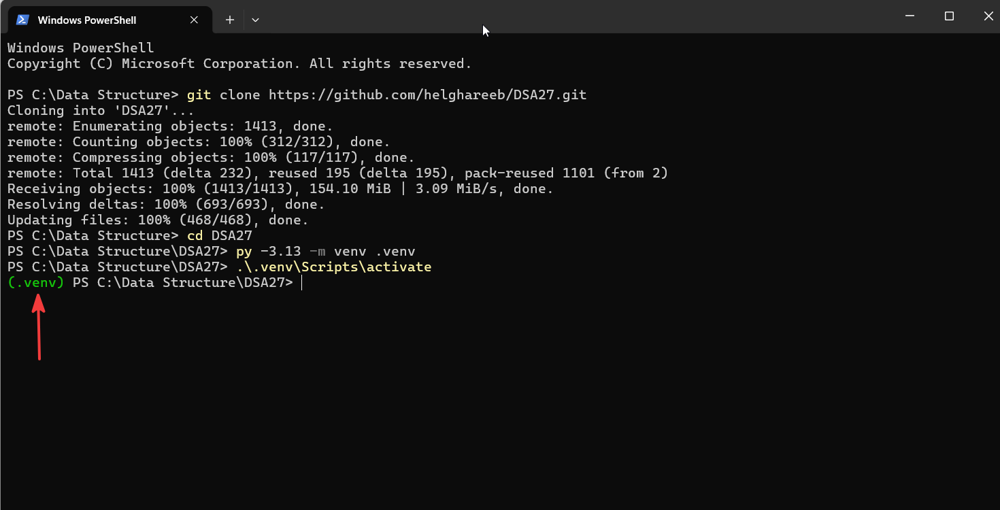

# دليل مذاكرة ريبو DSA27

**محتويات الدليل:** 

1. <a href="#section-1">Git & GitHub Simple Tutorial</a> 
2. <a href="#section-2">افهم الأول: إيه طبيعة الريبو ده؟</a>
3. <a href="#section-3">خريطة الريبو: كل فولدر بيعمل إيه؟</a> 
4. <a href="#section-4">Setup Environment</a>
5. <a href="#section-5">Before Start in DSA</a> 
6. <a href="#section-6">أذاكر كل محاضرة منين؟ وإيه المطلوب مني أعمله؟</a> 
7. <a href="#section-7">إزاي تحل الأكواد اللي الدكتور مديهالك؟</a> 
8. <a href="#section-8">Pytest Commands</a> 
9. <a href="#section-9">موارد إضافية وقواعد الكورس</a>  

---
# <span id="section-1">1. Git & GitHub</span>  

قبل ما تبدأ تذاكر من ريبو الكورس، محتاج تفهم إزاي الدكتور بيشارك الملفات والتحديثات معاك، وإزاي تحتفظ بنسختك على جهازك.

مش مطلوب منك تبقى محترف Git من أول يوم. المطلوب إنك تفهم الأساسيات اللي هتستخدمها فعلًا في الكورس.

## 1.1 يعني إيه Git ويعني إيه GitHub؟

الاتنين مرتبطين ببعض، لكن مش نفس الحاجة:

- **شرح Git:** برنامج بتثبّته على جهازك، وبيتابع التغييرات اللي بتحصل في ملفات المشروع. تقدر تحفظ نقاط من تاريخ شغلك (Commits)، وتشوف إيه اللي اتغيّر، وترجع لحالة سابقة عند الحاجة. وتقدر تستخدمه من غير إنترنت.
    
- **شرح GitHub:** موقع على الإنترنت بيستضيف المشاريع اللي بتستخدم Git، وبيسهّل مشاركة الكود والتعاون عليه. الدكتور بيرفع عليه ملفات الكورس والتحديثات، وإنت بتنزّلها على جهازك باستخدام Git.


في الكورس، الدكتور بيحدّث الملفات على GitHub، وإنت بتسحب التحديثات لجهازك باستخدام Git.


## 1.2 مصطلحات لازم تعرفها

| المصطلح               | معناه ببساطة                                                         | مثال في الكورس                                    |
| --------------------- | -------------------------------------------------------------------- | ------------------------------------------------- |
| Repository (Repo)     | المشروع وملفاته، بالإضافة إلى تاريخ التعديلات اللي بيتابعها Git.     | ريبو `DSA27`.                                     |
| Local Repository      | نسخة المشروع الموجودة على جهازك.                                     | فولدر `DSA27` بعد الـ Clone.                      |
| Remote Repository     | نسخة المشروع الموجودة على سيرفر خارجي، زي GitHub.                    | ريبو الدكتور على GitHub.                          |
| `origin`              | اسم افتراضي بيستخدمه Git للإشارة إلى الـ Remote اللي عملت منه Clone. | غالبًا بيشير لريبو الدكتور.                       |
| Clone                 | تنزيل نسخة من الريبو لأول مرة، مع تاريخ Git الخاص بيه.               | هتعمله مرة واحدة في البداية.                      |
| Pull                  | جلب التحديثات من الـ Remote ودمجها في نسختك المحلية.                 | لما الدكتور يحدّث الكورس.                         |
| Push                  | رفع الـ Commits الموجودة عندك إلى Remote.                            | مش هتقدر ترفع مباشرة لريبو الدكتور من غير صلاحية. |
| Commit                | تسجيل مجموعة تغييرات في تاريخ المشروع، مع رسالة بتوصفها.             | حفظ مرحلة من شغلك.                                |
| Fork                  | إنشاء نسخة من ريبو شخص تاني على حسابك في GitHub.                     | ممكن تستخدمه لو عايز تساهم في المشروع.            |
| `README.md`           | ملف بيشرح المشروع وبيظهر غالبًا في الصفحة الرئيسية للريبو.           | اقرأه قبل ما تبدأ.                                |
| Markdown (`.md`)      | صيغة كتابة نصوص منسّقة بعناوين وجداول وأكواد.                        | ملفات شرح المحاضرات.                              |

## 1.3 الصورة الكبيرة: التحديثات بتوصل لجهازك إزاي؟

في البداية، هتعمل `Clone` علشان تنزّل الريبو على جهازك. بعد كده، كل ما الدكتور يحدّث الملفات، تقدر تستخدم `Pull` علشان تجيب التحديثات الجديدة.

```
       GitHub (Remote)                  Your Computer (Local)

      ┌──────────────────┐              ┌──────────────────┐
      │                  │   git clone  │                  │
      │   DSA27 Repo     │ ───────────► │   DSA27 Folder   │
      │                  │              │                  │
      └──────────────────┘              └──────────────────┘
               │                                  ▲
               └──────────── git pull ────────────┘
```


## 1.4 اتعرّف على الريبو من موقع GitHub

أهم الحاجات اللي هتقابلها:

- **قائمة الملفات والفولدرات:** اضغط على أي فولدر علشان تفتحه، أو على أي ملف علشان تشوف محتواه.
    
- **README.md:** غالبًا هتلاقي محتواه ظاهر تحت قائمة الملفات. اقرأه الأول.
	
- **Code:** Clone الزرار الأخضر اللي منه تقدر تنسخ رابط ال 
	
- **Search files:**  من صفحة الريبو لفتح البحث السريع عن أسماء الملفات `t` تقدر تستخدم حرف 
    


## 1.5 Install Git on Windows

Before using Git, you need to install it on your computer.

Follow these steps to download and install Git:

### Step 1: Open the official Git website

1. Visit the official Git website: [https://git-scm.com/install/windows](https://git-scm.com/install/windows)
    
2. You will find the download options for Windows.
    
3. Click the download link for the latest **x64 version** of Git for Windows.
    
4. Wait for the installer to finish downloading.
	



> [!important]
> Most modern Windows computers use the x64 version. If your device uses an ARM processor, choose the ARM64 version instead.

### Step 2: Run the installer

1. Open your Downloads folder.
    
2. Double-click the downloaded `.exe` file.
    
3. If Windows asks for permission, click **Yes**.
    
4. The Git Setup wizard will appear.
    

	
5. Click **Next** to continue through the setup screens.
    
6. Let the default path, and press **next**.
	
7. This is a recommended components for smooth usage, then press **next**: 
	

	
8. Continue press next until reach to install window, and press install.
	
	*don't worry about all options, just leave it as it*   
	
9. Click **Finish**.
    
### Step 3: Verify the installation

After installation:

1. Press: `win + R` and write: `cmd`, then press enter.
    
2. Type the following command:
    

```
git --version
```

3. Press Enter.
    

If Git is installed correctly, you should see its version number.

Example:

```
git version 2.56.0.windows.1
```

Your version number may be different depending on the latest release.

**Congratulations!** Git is now installed and ready to use.


## 1.6 أساسيات الـ Terminal:

هتحتاج تكتب أوامر Git من خلال Terminal. ودي شوية أوامر بسيطة هتساعدك تتحرك بين الفولدرات:

| الأمر      | بيعمل إيه؟                                                    |
| ---------- | ------------------------------------------------------------- |
| `pwd`      | يعرض المسار الحالي اللي إنت واقف فيه.                         |
| `dir`      | يعرض الملفات والفولدرات الموجودة في المكان الحالي في Windows. |
| `ls`       | يعرض الملفات والفولدرات، وبيشتغل في PowerShell كمان.          |
| `cd DSA27` | يدخل جوه فولدر اسمه `DSA27`.                                  |
| `cd ..`    | يرجعك للفولدر الأب.                                           |
| `Ctrl + C` | يوقف الأمر الجاري تشغيله في الـ Terminal.                     |

## 1.7 أوامر Git الأساسية اللي هتحتاجها في الكورس:

مش مطلوب تحفظ كل أوامر Git. ركّز في الأوامر دي وافهم وظيفة كل واحد.

### 1. `git clone`

بتستخدمه أول مرة علشان تنزّل الريبو على جهازك:

### 2. `git pull`

بتستخدمه لما الدكتور يحدّث الريبو وعايز تجيب التغييرات الجديدة:

```
git pull origin main
```

نفّذ الأمر وإنت داخل فولدر المشروع.

### 3. `git status`

بيوضح حالة الملفات عندك:

```
git status
```

من أهم الأوامر اللي لازم تتعود تستخدمها؛ لأنه بيقولك هل فيه ملفات اتعدّلت، أو ملفات جاهزة للـ Commit، أو مشاكل محتاجة تتعامل معاها.

---

# <span id="section-2">2. افهم الأول: إيه طبيعة الريبو ده؟</span> 

ريبو [DSA27 على GitHub](https://github.com/helghareeb/DSA27) خاص بمادة Data Structures and Algorithms.

الفكرة الأساسية فيه إنك مش هتتعلم الـ Data Structures عن طريق استخدام الأدوات الجاهزة في Python فقط، لكن هتتعلم إزاي تبني الـ Data Structures بنفسك، وتفهم طريقة عملها، وتقيس كفاءتها.

الريبو بيقدم لك:

- محتوى نظري تتعلم منه الفكرة.
- ملفات Python تطبق فيها الفكرة بنفسك.
- اختبارات تحدد لك هل تنفيذك صحيح أم لا.
- حلول ترجع لها بعد المحاولة.
- أدوات رسم وقياس تساعدك تشوف سلوك الخوارزميات.
- أسئلة وتدريبات تجهزك للامتحان.

مثال: لما تيجي تذاكر Stack:

1. هتتعلم نظريًا يعني إيه Stack، وإيه مبدأ LIFO.
2. هتشوف إزاي بنبني Stack باستخدام Dynamic Array.
3. هتفتح ملف `dsa/stack.py` وتنفذ العمليات المطلوبة.
4. هتشغل الاختبارات الموجودة في `tests/` وتتأكد إن تنفيذك صحيح.
5. هتستخدم أدوات الرسم لو محتاج تشوف حركة العناصر.
6. هتحل أسئلة للتأكد إنك فاهم الفكرة وتقدر تشرحها.

يعني طريقة التعلم الأساسية:

**Understand → Implement → Test → Visualize → Practice**

## الريبو شغال إزاي من جوه؟

- كل Function جوه فولدر `dsa/` هي **Skeleton**: الـ Docstring بيقولك المطلوب بالظبط (الـ Contract) والتعقيد المستهدف (Complexity Target)، والجسم مجرد `raise NotImplementedError`.
- فولدر `tests/` هو اللي بيحدّد يعني إيه "صح". **كل الاختبارات بتفشل في اليوم الأول، وده هو الـ Assignment**: تكتب الكود لحد ما تنجح.

## القاعدة الأهم في الريبو: The Storage Rule

أي Structure في `dsa/` **مينفعش** يخزّن بياناته في `list` ولا `dict` ولا `set` بتوع Python. بتخزّن بس في الـ `Array` بتاع الكورس (`dsa/array.py`: حجم ثابت وفهرسة بـ O(1) وبس)، أو في Node Objects، أو في Structure تاني انت بنيته.

- الـ `list` ممكن تستخدمه تمرّر بيه بيانات جوه وبره، مش تخزّن فيه.
- مينفعش كمان تستخدم الـ Built-in اللي بتعيد تنفيذه (مثلًا `list.sort()` جوه `sorting.py`).
- الالتفاف على القاعدة ممكن ينجّح الاختبارات، بس مش هيعلّمك حاجة، والامتحان على ورق.

---

# <span id="section-3">3. خريطة الريبو: كل فولدر بيعمل إيه؟</span> 

دي المجلدات الرئيسية في الريبو:

```text
DSA27/
│
├── docs/            # lectures, lab manual, question bank, PDFs, regulations
├── dsa/             # * the structures & algorithms YOU implement
├── labs/            # weeks 1-3: Python lab exercises (you implement)
├── practice/        # question-bank coding problems (ungraded)
├── tests/           # * the tests that grade your code
├── solutions/       # worked solutions - open AFTER you try
├── notebooks/       # one Jupyter notebook per lecture
├── viz/             # drawing / animation / timing helpers (given)
├── tools/           # builds PDFs & figures - not for students
│
├── .vscode/         # VS Code settings + debugger configurations
├── README.md
├── requirements.txt
├── pytest.ini
├── .gitignore
└── .gitattributes

(+ a hidden .git/ folder: Git's own database - never touch it)
```

## أولًا: `docs/` — مكتبة المحتوى الدراسي

ده المكان اللي هترجع له باستمرار عشان تتعلم النظري وتعرف المطلوب منك.

جواه أجزاء مهمة:

```text
docs/
│
├── course/
│   └── regulations/
├── lectures/
├── labs/
├── question-bank/
├── pdf/
├── assets/
├── links.md
└── README.md
```

### A. `docs/course/`

ده المكان اللي فيه الملفات التنظيمية الخاصة بالكورس.

| الملف                | وظيفته                                                    |
| -------------------- | --------------------------------------------------------- |
| `00-course-guide.md` | تفهم طبيعة المادة وقواعدها (التقييم، الحضور، شروط النجاح) |
| `01-study-plan.md`   | تعرف موضوع كل أسبوع وملف الكود والاختبار المرتبط به       |
| `02-coverage.md`     | تعرف كل موضوع مطلوب في اللائحة وأين يتم تدريسه وتنفيذه    |
| `regulations/`       | لوائح البرامج الجامعية التي بُني عليها محتوى الكورس       |

الملفات دي بمثابة خريطة للمادة، اقرا الـ Guide والـ Plan **مرة في الأسبوع الأول**.

### B. `docs/lectures/`

ده المصدر الأساسي للشرح النظري.

مثلًا:

```text
lectures/
├── 01-why-this-course/
│   └── lecture.md
├── 02-complexity-and-arrays/
│   └── lecture.md
├── 03-recursion/
│   └── lecture.md
├── 04-dynamic-arrays/
│   └── lecture.md
...
```

- ملف `lecture.md` هو المحتوى الأصلي للمحاضرة، ومنه بتتولد نسخ الـ PDF. وكل فولدر فيه كمان فولدر `figures/` (الصور).
- والمحاضرات 2 و3 و5 و6 و7 فيها كمان ملف `*-lab.html` تفاعلي (Interactive Demo) بتفتحه في المتصفح وبيوريك الـ Structure وهي بتتحرك خطوة خطوة.

هتلاقي كمان نسختين PDF لكل محاضرة في `docs/pdf/`:

- **Handout:** النسخة اللي تقرأها وتذاكر منها.
- **Slides:** الشرائح المعروضة أثناء المحاضرة.

> المعلومات اللي مكتوبة في الـ Handout هي نفسها اللي موجودة في ملفات الـ Markdown، فاختار اللي يريحك في المذاكرة.

### C. `docs/labs/`

- ده اللي فيه العملي بتاع السكاشن.

- أول 3 أسابيع فيه هتكون شرح لأساسيات بايثون قبل الدخول في أي Data Structure.

### D. `docs/question-bank/`

ده بنك الأسئلة الخاص بالكورس.

هتلاقي لكل أسبوع ملفين:

- `weekNN-questions.md`: الأسئلة.
- `weekNN-answers.md`: الإجابات مع الشرح.

وفيه كمان امتحانات تجريبية (Mock Exams) هنتكلم عنها في القسم 10.

الأسئلة ممكن تكون:

- MCQ.
- تتبع تنفيذ الكود (Trace).
- تحليل Complexity.
- اكتشاف أخطاء.
- كتابة كود.
- أسئلة نظرية.

استخدمه بعد ما تخلص فهم المحاضرة والتطبيق، مش قبلهم.

### E. `docs/pdf/` و`docs/assets/`

- فولدر `pdf/`: نسخ PDF الجاهزة: Handout وSlides لكل محاضرة، وLab لكل أسبوع، والـ Students' Book (كل المحاضرات + بنك الأسئلة بحلوله)، و`DSA27-Lab-Manual.pdf`. 
- فولدر `assets/`: صورة الـ QR بتاعة قناة WhatsApp.

### F. `docs/course/regulations/`

لوائح البرامج الجامعية التي بُني عليها محتوى الكورس. وفيه ملف `dsa-in-your-program.md` بيلخّص كل اللي بتقوله اللوائح عن المادة، فمش لازم تفتح الـ PDFs نفسها.

### G. `docs/links.md` و`docs/README.md`

- فولدر `links.md`: اللينكات المهمة (قناة WhatsApp للإعلانات، YouTube، موقع الكورس والكويزات، الريبو).
- فولدر `README.md`: فهرس لكل حاجة في `docs/` بروابطها.

---

## ثانيًا: `dsa/` — أهم فولدر في التطبيق العملي

ده المكان اللي هتنفذ فيه الـ Data Structures والـ Algorithms بنفسك.

الملفات الموجودة وارتباطها بخطة الدراسة:

| File                     | Week    | Content                                                                                                                                    | Test                          |
| ------------------------ | ------- | ------------------------------------------------------------------------------------------------------------------------------------------ | ----------------------------- |
| `array.py`               | جاهز    | The course’s own `Array`: fixed size, O(1) indexing. The foundation that the other structures are built on (**not an exercise**).          | —                             |
| `array_ops.py`           | 2       | Operations on a partially filled Array (insert / remove / reverse / rotate).                                                               | `test_array_ops.py`           |
| `recursion.py`           | 3       | Recursion: base case, recursive case, fast exponentiation, Towers of Hanoi, `merge_sorted`.                                                | `test_recursion.py`           |
| `dynamic_array.py`       | 4       | `DynamicArray`: grows by doubling, with amortised O(1) append.                                                                             | `test_dynamic_array.py`       |
| `linked_list.py`         | 5       | `Node` and `LinkedList`: insert / remove / reverse.                                                                                        | `test_linked_list.py`         |
| `stack.py`               | 6       | Stack (LIFO), balanced brackets, infix → postfix (shunting-yard).                                                                          | `test_stack_queue.py`         |
| `queue.py`               | 7       | `SlowQueue` (O(n)) and `CircularQueue` (O(1)) side by side, so you can measure the difference.                                             | `test_stack_queue.py`         |
| `searching.py`           | 8       | 8 search functions: linear, binary, binary recursive, lower/upper bound, jump, exponential, interpolation.                                 | `test_searching.py`           |
| `sorting.py`             | 9–10    | Bubble / selection / insertion / counting, then merge / quick / heap. Each sort has a `_steps` version that is a generator, for animation. | `test_sorting.py`             |
| `tree.py`                | 11      | BST with the 3 delete cases and the 4 traversals.                                                                                          | `test_tree.py`                |
| `heap.py`                | 12      | Heap with `sift_up` / `sift_down`, build-heap, and priority queue.                                                                         | `test_heap.py`                |
| `hashmap.py`             | 13      | Hash table implemented twice: chaining and open addressing (with tombstones).                                                              | `test_hashmap.py`             |
| `graph.py`               | 14      | Graph: adjacency list and matrix, BFS and DFS, components, cycles, topological sort.                                                       | `test_graph.py`               |
| `translation.py`         | 15 (+6) | tokenize → Parser → AST → evaluate (and `evaluate_postfix` in week 6).                                                                     | `test_translation.py`         |
| `dynamic_programming.py` | إضافي   | Dynamic programming: fib, coin change, LCS, edit distance, and so on. **Not in the exam.**                                                 | `test_dynamic_programming.py` |
| `__init__.py`            | —       | Marks the folder as a package and states the “don’t use the built-in” rule.                                                                | —                             |

مثلًا، في Week 4 بتذاكر Dynamic Array.

هتفتح:

```text
dsa/dynamic_array.py
```

هتلاقي فيه Class أو Functions الدكتور مجهزها لك، لكن أجزاء من التنفيذ ناقصة.

هتلاقي سطر زي:

```python
raise NotImplementedError
```

وده معناه إن الدكتور سايب لك مكان التنفيذ.

**المطلوب منك:** تفهم المطلوب من كل Function وتكتب الكود اللي يحقق المطلوب.

مهم جدًا تفهم قاعدة الكورس (The Storage Rule اللي فوق): ممنوع تستخدم Python `list` لبناء الـ Dynamic Array، أو `dict` لبناء الـ HashMap؛ لأن الهدف إنك تنفذ البنية بنفسك، مش تستدعي البنية الجاهزة.

---

## ثالثًا: `tests/` — الاختبارات التي تتحقق من كودك

ده من أهم الفولدرات اللي لازم تتعلم تتعامل معاها.

كل ملف في `dsa/` و `labs/` و `practice/`  له ملف اختبار مرتبط به في `tests/`.

| الكود اللي بتنفذه | الاختبار |
|---|---|
| `dsa/array_ops.py` | `tests/test_array_ops.py` |
| `dsa/recursion.py` | `tests/test_recursion.py` |
| `dsa/dynamic_array.py` | `tests/test_dynamic_array.py` |
| `dsa/linked_list.py` | `tests/test_linked_list.py` |
| `dsa/stack.py` و`queue.py` | `tests/test_stack_queue.py` |
| `dsa/searching.py` | `tests/test_searching.py` |
| `dsa/sorting.py` | `tests/test_sorting.py` |
| `labs/lab01.py` … `lab03.py` | `tests/test_lab01.py` … `test_lab03.py` |
| `practice/weekNN.py` | `tests/test_practice_weekNN.py` |

وفيه كمان ملفين مش مرتبطين بتمرين:

- ملف `test_environment.py`: فحص الـ Setup (ده الوحيد اللي مش `challenge`).
- ملف `conftest.py`: بيخلّي `import dsa` يشتغل وبيضيف خيار `--solutions`.

### إيه فايدة الاختبارات؟

افترض إن عندك Function اسمها:

```python
def pop(self):
    raise NotImplementedError
```

الدكتور مجهز اختبار بيتأكد من حاجات مثل:

- هل `pop()` بترجع آخر عنصر؟
- هل بتحذف العنصر فعلًا؟
- هل حجم الـ Stack بيقل؟
- هل بتتصرف صح لو الـ Stack فاضي؟

بدل ما تعتمد على إنك تجرب مثالًا واحدًا وتقول إن الكود شغال، الاختبارات بتجرب حالات مختلفة.

تشغيل اختبار ملف معين:

```powershell
pytest tests/test_dynamic_array.py -v
```

والـ `-v` معناها Verbose، أي يعرض تفاصيل الاختبارات.

### الـ Markers

الاختبارات متقسّمة بـ 3 علامات (Markers) معرّفة في `pytest.ini`:

| الـ Marker | معناه |
|---|---|
| `challenge` | تمرين لسه متكتبش (كل تمارين `dsa/` و`labs/` و`practice/`) |
| `lab` | تمارين الأسابيع 1–3 |
| `practice` | مسائل الـ Question Bank |

**خلي بالك:** الاختبارات مش مجرد أداة للتصحيح؛ هي جزء من طريقة مذاكرتك وفهمك للمطلوب. ومتعدّلش فيها.

---

## رابعًا: `labs/` — تمارين تأسيس Python

فيه نقطة مهمة، فيه فولدرين بأسماء متشابهة:

- فولدر `docs/labs/`: **الشرح** (ملفات Markdown من Lab01 لحد Lab15).
- فولدر `labs/`: **ملفات Python** اللي هتكتب فيها تمارين العملي التأسيسي، في أول 3 أسابيع بس (`lab01.py` و`lab02.py` و`lab03.py`).

يعني لما تقرأ Lab 01 من `docs/labs/`، هتلاقيه بيطلب منك تنفيذ التمارين في:

```text
labs/lab01.py
```

وبعدها تختبرها باستخدام:

```powershell
pytest tests/test_lab01.py
```

ونفس الفكرة مع Lab 02 وLab 03. من الأسبوع 4، الـ Lab بتاعك هو فولدر `dsa/`.

---

## خامسًا: `practice/` — مسائل إضافية

ده مخصص لمسائل البرمجة المرتبطة بالـ Question Bank (`week01.py` … `week15.py`).

الفرق بينه وبين `dsa/`:

- `dsa/`: تنفيذ هياكل البيانات والخوارزميات المطلوبة في الكورس (تنفيذ الكود).
- `practice/`: حل مسائل برمجية إضافية للتدريب على الأفكار. لكن **من غير درجات**. 

يعني `practice/` تمارين اضافية، لو خلصت الأساسي ابقي ذاكره.
- الفولدر ده فيه جانب الأكواد اللي موجودة في الـ Question Bank بالظبط، والفرق إن `docs/question-bank` فيه شرح الإجابة بجانب السؤال.

تقدر تختبر تمارين Practice باستخدام:

```powershell
pytest -m practice
```

أو لأسبوع معين:

```powershell
pytest tests/test_practice_weekNN.py -v
```

---

## سادسًا: `solutions/` — الحلول الجاهزة

ده المكان اللي هتلاقي فيه حلول التمارين (نفس هيكل الريبو: `solutions/dsa/` و`solutions/labs/` و`solutions/practice/`).

لكن مش عايزك تفتحه أول ما تقابل تمرين صعب.

استخدمه بالترتيب ده:

1. حاول تحل بنفسك.
2. لو وقفت، اقرأ الـ Docstring والاختبار مرة تانية.
3. حاول تتبع التنفيذ باستخدام Debugger.
4. لو لسه مش قادر، افتح الحل.
5. افهم ليه الحل اتكتب بالطريقة دي.
6. اقفل الحل واكتبه بنفسك من الذاكرة.

الدكتور مجهز `solutions/` بحيث إن الحلول الموجودة فيه ممكن تحل محل الـ Skeleton أثناء تشغيل الاختبارات باستخدام إعدادات المشروع.
- الفرق بينه وبين `tests/` : هي ان `tests/` بيقولك انت حليت الكود صح ولا لأ = بيصححه يعني، انما لو عايز تشوف الحل والكود الصح مكتوب من الدكتور ف ده في `solutions/` .

الأمر الخاص بتشغيل الاختبارات على الحلول:

```powershell
pytest --solutions tests/test_stack_queue.py -v
```

مش مطلوب منك تنسخ الحلول داخل `dsa/` عشان تختبرها، وكودك مبيتلمسش. وده كمان بيساعدك تعرف: الغلط في كودك ولا في فهمك للاختبار؟

---

## سابعًا: `notebooks/` — مساحة التجارب والاستكشاف

ملفات Jupyter Notebook امتدادها `.ipynb`: واحد لكل محاضرة (من `01` لـ `15`) + `00-environment-check.ipynb` لفحص الـ Setup.

تقدر تكتب فيها كود Python، وتشغله، وتشوف الناتج، وتضيف شرحًا نصيًا ورسومات في نفس الملف.

الفرق بينها وبين ملفات `.py`:

| `.py` | `.ipynb` |
|---|---|
| تكتب فيه البرنامج وتحفظه | تكتب كودًا وتجربه في خلايا منفصلة |
| مناسب للتنفيذ النهائي والاختبارات | مناسب للاستكشاف والتجربة والرسم |
| لا يحتفظ عادةً بمخرجات التنفيذ داخل الملف | يمكنه عرض المخرجات والرسومات بجانب الكود |

استخدمه عشان تجرب أفكار المحاضرة، وتشوف سلوك الخوارزميات، وتغير المدخلات وتلاحظ النتائج.

- تفتحه مباشرة في VS Code وتختار `.venv` كـ Kernel (أو الـ Kernel اسمه `DSA27 (Python 3.13)`).
---

## ثامنًا: `viz/` — أدوات الرسم والقياس

ده فولدر جاهز فيه أدوات الدكتور اللي هتساعدك تشوف اللي بيحصل داخل الـ Data Structures. وبياخد بيانات Python عادية ومبيعملش Import لـ `dsa/`.

مثلًا:

- `draw_array`: رسم Array.
- `draw_linked_list`: رسم Linked List.
- `draw_tree`: رسم Tree.
- `draw_array_as_tree`: Tree علي هيئة Array عرض 
- `draw_graph`: رسم Graph.
- `animate.py`: تحريك خطوات بعض الخوارزميات (`animate_bars` و`step_slider`).
- `complexity.py`: قياس الوقت ورسم نمو الأداء (`measure` و`plot_growth`).
- `style.py`: ألوان وأحجام الرسم.

الفكرة إنك بدل ما تتخيل حركة العناصر، تقدر تشوفها.

```python
from viz.draw import draw_array, draw_linked_list

draw_array([5, 2, 9, 1], highlight=2, done=[0])
draw_linked_list(["a", "b", "c"], highlight=1)
```

مثلًا في Sorting، ممكن تكتب الخوارزمية كـ Generator يرجع Snapshot بعد كل خطوة، وبعدها تستخدم أدوات `viz` لعرض الحركة.
- والميزة ده الدكتور مجهزها في الملفات اللي موجودة في فولدر : `notebooks/`  
- وعشان تشغل الميزة ده في `notebooks/` محتاج أول م تدخل الملف تعمل **run** للكود اللي في أول الملف الأول عشان باقي الأكواد تشتغل معاك عادي.

**مهم:** الدكتور مجهز أدوات التصور دي بالفعل؛ مش مطلوب منك تبني أدوات الرسم من الصفر.

---

## تاسعًا: `tools/` وملفات الإعدادات

- ملف `tools/`: أدوات مساعدة لبناء ملفات PDF والرسومات الخاصة بالمحاضرات. الطلبة مش محتاجينها (`tools/README.md` بيقول كده صراحة).
- ملف `.vscode/`: إعدادات خاصة ببيئة VS Code: `settings.json` (بيختار الـ Interpreter بتاع `.venv` ويفعّل `pytest`) و`launch.json` (إعدادات الـ Debug).
- ملف `requirements.txt`: المكتبات المطلوبة للمشروع بنسخها المحددة (`pytest` و`matplotlib` و`networkx` و`jupyterlab` و`graphviz` و`nbstripout` وغيرهم). بتديه لـ `pip install -r` مرة واحدة.
- ملف `pytest.ini`: إعدادات Pytest، ومنها تنظيم الاختبارات وعلاماتها (Markers).
- ملف `README.md`: دليل المشروع الرئيسي. اقراه كله مرة.
- ملف `.gitignore`: الملفات التي لا يريد Git تتبعها (`.venv/` و`__pycache__/` ...).
- ملف `.gitattributes`: قواعد التعامل مع بعض أنواع الملفات (توحيد نهاية الأسطر بين Windows وmacOS/Linux).

مش مطلوب تعرف التفاصيل ده، بس من باب العلم بالشيء.

### Summary


| المسار                            | بتعمل إيه                                                                                                         |
| --------------------------------- | ----------------------------------------------------------------------------------------------------------------- |
| `docs/lectures/NN-.../lecture.md` | شرح المحاضرة نفسها: الفكرة والتعقيد وليه. بتقراها قبل المحاضرة وبعدها.                                            |
| `docs/labs/labNN-...md`           | دليل الـ Lab خطوة بخطوة: بيمشّيك جزء جزء وبيقولك تشغّل أنهي اختبار.                                               |
| `dsa/`                            | هنا بتكتب كود الأسبوع بنفسك (ملف لكل موضوع، زي `linked_list.py` و`stack.py`).                                     |
| `labs/`                           | نفس فكرة `dsa/` بس لتمارين Python الأولانية في الأسابيع 1 لـ 3 بس.                                                |
| `tests/`                          | الاختبارات اللي بتصحّح كودك. لما واحد يفشل بتقراه عشان تعرف المطلوب بالظبط، ومتعدّلش فيه.                         |
| `practice/`                       | مسائل برمجة إضافية بتحلها بعد ما تخلّص الأسبوع، وبتتصحّح تلقائي.(نفس المسائل البرمجية اللي موجودة في بنك الأسئلة) |
| `docs/question-bank/`             | أسئلة وإجابات كل أسبوع، للتدريب على شكل أسئلة الامتحان.                                                           |
| `solutions/`                      | الحلول الجاهزة. بتفتحها بعد ما تحاول بجد بس.                                                                      |

---

# <span id="section-4">4. Setup environment</span> 

ده كله بتعمله **مرة واحدة** في أول الكورس. مكتوب لـ **Windows + PowerShell** .

## 4.1 الأول: نزّل البرامج دي (من النت، مش Commands)

### 1. Python 3.13

من [Python 3.13.17](https://www.python.org/downloads/release/python-31317/) 
الريبو بيطلب 3.10 أو أحدث، **والكورس بيستخدم 3.13**، فنزّلها هي. في أول شاشة للـ Installer علّم على **Add python.exe to PATH**.

### 2. Graphviz

من [Graphviz](https://graphviz.org/download/) 

لازم **البرنامج نفسه** (الـ `dot` binary) مش بس مكتبة pip. في الـ Installer علّم على إضافته للـ PATH، وبعد التنصيب **اقفل الـ Terminal وافتح واحد جديد**.

### 3. VS Code + إضافتي Python وJupyter

الريبو مظبوط على VS Code (فولدر `.vscode/`) وبيستخدمه في الـ Debugging.

 
> [!important]
> **فخ Windows [من الريبو]:** لو كتبت `python` وفتح لك Microsoft Store بدل ما يشتغل: روح *Settings → Apps → Advanced app settings → App execution aliases* وقفّل `python.exe` و`python3.exe`.


## 4.2 اتأكد إن كل حاجة اتنصّبت 

```powershell
git --version
py --version
dot -V
```

المفروض كل واحد يطبع نسخة. لو `dot -V` قال إن الأمر مش معروف، يبقى Graphviz مش في الـ PATH.

## 4.3 نزّل الريبو 

1. هتروح للمكان اللي عايز تحفظ فيه حاجة الريبو.
2. وتدوس Right Click، وبعد كدة اختار `Open in Terminal` :

	
3. Run this commands:
```powershell
git clone https://github.com/helghareeb/DSA27.git
cd DSA27
```

## 4.4 اعمل الـ Virtual Environment وفعّله

الـ Virtual Environment (`.venv`) هو "علبة" لمكتبات الكورس لوحدها، فمبتتخبطش في مكتبات تانية على جهازك.
- Run this commands:
```powershell
py -3.13 -m venv .venv
.\.venv\Scripts\activate
```

لما يشتغل هتلاقي `(.venv)` في أول سطر الـ Terminal. **لازم تفعّله من جديد في أي Terminal تفتحه** (السطر التاني بس).
```powershell
.\.venv\Scripts\activate
```

> [!warning]
> **لو ظهر `running scripts is disabled on this system` :** ده منع افتراضي في PowerShell. شغّل مرة واحدة الأمر ده ووافق:

```powershell
Set-ExecutionPolicy -Scope CurrentUser -ExecutionPolicy RemoteSigned
```
- وبعد كدة شغل أمر ال Activate تاني، اللي هو السطر التاني بس.

- المفروض في الآخر يكون ده الشكل معاك:

## 4.5 نزّل المكتبات

```powershell
pip install -r requirements.txt
```

هياخد كام دقيقة لأنه بينزّل حوالي 109 Package.

## 4.6 فعّل تنضيف الـ Notebooks (مرة واحدة)

```powershell
nbstripout --install
```

ده بيخلّي الـ Outputs تتمسح تلقائي من الـ Notebooks لما تعمل Commit، فالـ diff بتاعك يبقى نضيف.

## 4.7 الاختبار الحاسم: الـ Environment Check

```powershell
pytest -m "not challenge"
```

**كل الاختبارات دي لازم تنجح.** بتتأكد من نسخة Python، وإنك جوه الـ `.venv`، وإن المكتبات اتنصّبت، وإن Graphviz موجود، وإن الرسم شغّال. لو واحد فشل، الرسالة بتقولك إيه الناقص. حلّه قبل ما تشك في كودك.

| لو فشل                                 | غالبا السبب                                                   | الحل                                                                        |
| -------------------------------------- | ------------------------------------------------------------- | --------------------------------------------------------------------------- |
| `test_graphviz_dot_binary_is_on_path`  | Graphviz is not installed, or it is not on the PATH.          | Install it, tick the option to add it to the PATH, and open a new Terminal. |
| `test_running_inside_the_project_venv` | You forgot to activate `.venv`.                               | run this command : `.\.venv\Scripts\activate`                               |
| `test_python_version_is_at_least_3_10` | Your Python version is too old.                               | Install Python 3.13.                                                        |
| `test_required_package_imports`        | `pip install` did not finish, or it was run outside the venv. | Activate the venv and run `pip install -r requirements.txt` again.          |


---

# <span id="section-5">5. Before Start in DSA:</span> 

الدكتور عامل حساب إن الطلاب ممكن يكونوا بمستويات مختلفة في Python؛ لذلك أول 3 Labs معمولين عشان يوصلوا الطلاب لأساس مشترك في اللغة.

**المطلوب منك قبل التعمق في هياكل البيانات هو دراسة Labs 01 و02 و03.**

هتلاقي شرحهم في:

```text
docs/labs/
```

## Lab 01 — Python Basics

الملف:

```text
docs/labs/lab01-python-basics.md
```

### الموضوعات اللي تذاكرها:

- تشغيل Python: REPL وScripts.
- المتغيرات وأنواع البيانات الأساسية.
- العمليات الحسابية: `/` و`//` و`%` و`**`.
- Strings: indexing ,slicing and methods.
- Lists: الإنشاء والتعديل والإضافة والحذف.
- `while` و`if` بشكل مبدئي.
- `print` مقابل `return`.

### التطبيق المطلوب:

- افتح `labs/lab01.py`.
- نفّذ الـ 10 Functions الموجودة فيه.
- اختبرها باستخدام:

```powershell
pytest tests/test_lab01.py
```

رابط الشرح: [Lab 01 — Python Basics](https://github.com/helghareeb/DSA27/blob/main/docs/labs/lab01-python-basics.md)

## Lab 02 — Control Flow, Functions, Errors, Modules

الملف:

```text
docs/labs/lab02-control-flow-functions.md
```

### الموضوعات اللي تذاكرها:

- شروط `if / elif / else`.
- حلقات `for` و`while`.
- Functions وParameters وArguments.
- `return` وScope.
- التعامل مع Errors وExceptions.
- Modules وImports.
- فهم كيفية تقسيم البرنامج إلى ملفات.

### التطبيق:

حل تمارين:

```text
labs/lab02.py
```

واختبرها باستخدام:

```powershell
pytest tests/test_lab02.py
```

## Lab 03 — Data Structures, Classes, Generators

الملف:

```text
docs/labs/lab03-data-structures-classes.md
```

### الموضوعات اللي تذاكرها:

- Tuples وDictionaries وSets.
- Classes وObjects.
- Attributes وMethods و`__init__`.
- فكرة OOP الأساسية.
- Iterators وGenerators و`yield`.

### التطبيق:

حل تمارين:

```text
labs/lab03.py
```

واختبرها باستخدام:

```powershell
pytest tests/test_lab03.py
```

### أذاكر المعامل دي إزاي؟

مش عايزك تتعامل معاها كأنها كتاب تقرأه وخلاص. كل Lab معمول كدليل عملي.

امشِ بالترتيب ده:

1. افتح ملف الـ Lab واقرأ الجزء النظري الصغير من `docs/labs`.
2. افتح Python أو VS Code وجرب كل مثال بنفسك، واكتب الكود بدل النسخ واللصق.
3. لما تلاقي `Try it`، وقف وحاول تنفذ المطلوب.
4. لما تلاقي `Checkpoint`، توقع الناتج قبل تشغيل الكود.
5. بعد ما تفهم الأمثلة، افتح ملف التمارين في `labs/` وابدأ حلها.
6. شغّل الاختبارات، وراجع أي خطأ يظهر لك، باستخدام الـ Command ده:

```powershell
pytest tests/اسم_الملف -v
```

مثلًا في Lab 01، الدكتور طالب منك تنفيذ 10 Functions صغيرة، زي:

- تحويل الثواني إلى ساعات ودقائق وثوانٍ.
- تحويل Celsius إلى Fahrenheit.
- استخراج Initials من الاسم.
- التحقق من Palindrome.
- تدوير عناصر List.
- حساب عدد خطوات Collatz.

دي مش تمارين عشوائية؛ كل واحدة بتدربك على جزء من Python.


>خد بالك إن Labs 01–03 متزامنة في خطة الدكتور مع أول 3 محاضرات، مش شرط تخلصها كلها قبل حضور المحاضرات. لكن لو انت لسه محتاج تأسيس Python، فمن الأفضل تعمل التأسيس ده قبل الدخول بعمق في تنفيذ هياكل البيانات.

---

# <span id="section-6">6. أذاكر كل محاضرة منين؟ وإيه المطلوب مني أعمله؟</span> 

كل أسبوع في `01-study-plan.md` فيه 3 معلومات أساسية:

- **Topic:** الموضوع النظري.
	- Lectures
	- Labs (السيكشن)
- **Implement:** ملف الكود اللي هتشتغل عليه.
- **Graded by:** ملف الاختبار اللي هيتأكد من صحة تنفيذك.


## أسماء الملفات لكل أسبوع

| Wk  | Topic                      | Lectures                                                                    | Labs                                                                      | Implementation                                                           | Graded by                                                                                       |
| --- | -------------------------- | --------------------------------------------------------------------------- | ------------------------------------------------------------------------- | ------------------------------------------------------------------------ | ----------------------------------------------------------------------------------------------- |
| 1   | Why this course, ADTs, OOP | [01-why-this-course](01%20Areas/College/Data%20Structure%20&%20Algorithms/lectures/01-why-this-course/lecture.md)             | [lab01-python-basics](01%20Areas/College/Data%20Structure%20&%20Algorithms/labs/lab01-python-basics.md)                     | [lab01.py](../../labs/lab01.py)                                          | [test_lab01.py](../../tests/test_lab01.py)                                                      |
| 2   | Complexity and Array       | [02-complexity-and-arrays](01%20Areas/College/Data%20Structure%20&%20Algorithms/lectures/02-complexity-and-arrays/lecture.md) | [lab02-control-flow-functions](01%20Areas/College/Data%20Structure%20&%20Algorithms/labs/lab02-control-flow-functions.md)   | [array_ops.py](../../dsa/array_ops.py) + [lab02.py](../../labs/lab02.py) | [test_array_ops.py](../../tests/test_array_ops.py) + [test_lab02.py](../../tests/test_lab02.py) |
| 3   | Recursion                  | [03-recursion](01%20Areas/College/Data%20Structure%20&%20Algorithms/lectures/03-recursion/lecture.md)                         | [lab03-data-structures-classes](01%20Areas/College/Data%20Structure%20&%20Algorithms/labs/lab03-data-structures-classes.md) | [recursion.py](../../dsa/recursion.py) + [lab03.py](../../labs/lab03.py) | [test_recursion.py](../../tests/test_recursion.py) + [test_lab03.py](../../tests/test_lab03.py) |
| 4   | Dynamic Arrays             | [04-dynamic-arrays](01%20Areas/College/Data%20Structure%20&%20Algorithms/lectures/04-dynamic-arrays/lecture.md)               | [lab04-dynamic-arrays](01%20Areas/College/Data%20Structure%20&%20Algorithms/labs/lab04-dynamic-arrays.md)                   | [dynamic_array.py](../../dsa/dynamic_array.py)                           | [test_dynamic_array.py](../../tests/test_dynamic_array.py)                                      |
| 5   | Linked Lists               | [05-linked-lists](01%20Areas/College/Data%20Structure%20&%20Algorithms/lectures/05-linked-lists/lecture.md)                   | [lab05-linked-lists](01%20Areas/College/Data%20Structure%20&%20Algorithms/labs/lab05-linked-lists.md)                       | [linked_list.py](../../dsa/linked_list.py)                               | [test_linked_list.py](../../tests/test_linked_list.py)                                          |
| 6   | Stacks                     | [06-stacks](01%20Areas/College/Data%20Structure%20&%20Algorithms/lectures/06-stacks/lecture.md)                               | [lab06-stacks](01%20Areas/College/Data%20Structure%20&%20Algorithms/labs/lab06-stacks.md)                                   | [stack.py](../../dsa/stack.py)                                           | [test_stack_queue.py](../../tests/test_stack_queue.py)                                          |
| 7   | Queues                     | [07-queues](01%20Areas/College/Data%20Structure%20&%20Algorithms/lectures/07-queues/lecture.md)                               | [lab07-queues](01%20Areas/College/Data%20Structure%20&%20Algorithms/labs/lab07-queues.md)                                   | [queue.py](../../dsa/queue.py)                                           | [test_stack_queue.py](../../tests/test_stack_queue.py)                                          |
| 8   | Searching (midterm window) | [08-searching](01%20Areas/College/Data%20Structure%20&%20Algorithms/lectures/08-searching/lecture.md)                         | [lab08-searching](01%20Areas/College/Data%20Structure%20&%20Algorithms/labs/lab08-searching.md)                             | [searching.py](../../dsa/searching.py)                                   | [test_searching.py](../../tests/test_searching.py)                                              |
| 9   | Basic Sorting              | [09-sorting-basic](01%20Areas/College/Data%20Structure%20&%20Algorithms/lectures/09-sorting-basic/lecture.md)                 | [lab09-sorting-basic](01%20Areas/College/Data%20Structure%20&%20Algorithms/labs/lab09-sorting-basic.md)                     | [sorting.py](../../dsa/sorting.py)                                       | [test_sorting.py](../../tests/test_sorting.py)                                                  |
| 10  | Advanced Sorting           | [10-sorting-advanced](01%20Areas/College/Data%20Structure%20&%20Algorithms/lectures/10-sorting-advanced/lecture.md)           | [lab10-sorting-advanced](01%20Areas/College/Data%20Structure%20&%20Algorithms/labs/lab10-sorting-advanced.md)               | [sorting.py](../../dsa/sorting.py)                                       | [test_sorting.py](../../tests/test_sorting.py)                                                  |
| 11  | Trees                      | [11-trees](01%20Areas/College/Data%20Structure%20&%20Algorithms/lectures/11-trees/lecture.md)                                 | [lab11-trees](01%20Areas/College/Data%20Structure%20&%20Algorithms/labs/lab11-trees.md)                                     | [tree.py](../../dsa/tree.py)                                             | [test_tree.py](../../tests/test_tree.py)                                                        |
| 12  | Heaps and Priority Queues  | [12-heaps](01%20Areas/College/Data%20Structure%20&%20Algorithms/lectures/12-heaps/lecture.md)                                 | [lab12-heaps](01%20Areas/College/Data%20Structure%20&%20Algorithms/labs/lab12-heaps.md)                                     | [heap.py](../../dsa/heap.py)                                             | [test_heap.py](../../tests/test_heap.py)                                                        |
| 13  | Hash Tables                | [13-hash-tables](01%20Areas/College/Data%20Structure%20&%20Algorithms/lectures/13-hash-tables/lecture.md)                     | [lab13-hash-tables](01%20Areas/College/Data%20Structure%20&%20Algorithms/labs/lab13-hash-tables.md)                         | [hashmap.py](../../dsa/hashmap.py)                                       | [test_hashmap.py](../../tests/test_hashmap.py)                                                  |
| 14  | Graphs                     | [14-graphs](01%20Areas/College/Data%20Structure%20&%20Algorithms/lectures/14-graphs/lecture.md)                               | [lab14-graphs](01%20Areas/College/Data%20Structure%20&%20Algorithms/labs/lab14-graphs.md)                                   | [graph.py](../../dsa/graph.py)                                           | [test_graph.py](../../tests/test_graph.py)                                                      |
| 15  | Language Translation       | [15-language-translation](01%20Areas/College/Data%20Structure%20&%20Algorithms/lectures/15-language-translation/lecture.md)   | [lab15-language-translation](01%20Areas/College/Data%20Structure%20&%20Algorithms/labs/lab15-language-translation.md)       | [translation.py](../../dsa/translation.py)                               | [test_translation.py](../../tests/test_translation.py)                                          |


> ملاحظة : `dsa/dynamic_programming.py` إثراء ومش في الامتحان.

---
# <span id="section-7">7. إزاي تحل الأكواد اللي الدكتور مديهالك؟</span> 

لما الدكتور يقول لك «حل الكود»، مش بالضرورة يقصد إنك تكتب برنامجًا كاملًا من الصفر.

هتلاقي **Skeleton Code**، يعني هيكل الكود جاهز، لكن أجزاء من التنفيذ ناقصة.

خلينا نعمل مثال بسيط من عندنا للتوضيح.

افترض إن الدكتور طلب منك تنفيذ Stack، وعندك الكود ده:

```python
class Stack:

    def __init__(self):
        self.items = []

    def push(self, value):
        raise NotImplementedError

    def pop(self):
        raise NotImplementedError

    def peek(self):
        raise NotImplementedError
```

إيه المطلوب منك؟

المطلوب إنك تكمل الـ Methods الناقصة بحيث تحقق السلوك المطلوب.

مثلًا:

- `push(value)`: Stack تضيف عنصرًا أعلى الـ .
- `pop()`: تحذف وترجع آخر عنصر.
- `peek()`: ترجع آخر عنصر دون حذفه.

لكن المثال السابق للتوضيح فقط، واستخدمنا فيه Python `list` للتبسيط. في المشروع الحقيقي لازم تلتزم بتصميم الدكتور وقاعدة التخزين الخاصة بالكورس. وفعلًا في `dsa/stack.py` الحقيقي، الـ Stack بتخزّن عناصرها في `DynamicArray` اللي نفذتها بنفسك في الأسبوع 4 (`self._items = DynamicArray()`).

## أعرف أكتب إيه داخل كل Function منين؟

عندك 3 مصادر أساسية:

### 1. Docstring

ده الشرح الموجود داخل الـ Function، وغالبًا بيحدد:

- وظيفة الـ Function.
- Parameters التي تستقبلها.
- القيمة التي يجب أن ترجعها.
- الحالات الخاصة.
- أحيانًا الـ Complexity المطلوبة.

مثال حقيقي من `dsa/linked_list.py`:

```python
def push_front(self, value):
    """Insert at the head. Target: O(1)."""
    raise NotImplementedError
```

الـ Docstring هو الـ Contract، و`Target: O(1)` هو التعقيد اللي المفروض توصله. انت بتمسح `raise NotImplementedError` وتكتب جسم الدالة.

### 2. Tests

بتوضح لك السلوك المتوقع من خلال أمثلة واختبارات فعلية.

مثال حقيقي من `tests/test_linked_list.py`:

```python
def test_push_front_reverses_insertion_order():
    ll = LinkedList()
    for value in (1, 2, 3):
        ll.push_front(value)
    assert list(ll) == [3, 2, 1]
```

يعني لو فشل الاختبار، **اقرا الـ `assert`** وهتعرف بالظبط الدالة المفروض ترجع إيه.

### 3. Lecture

بتشرح الفكرة والخوارزمية اللي هتستخدمها عشان تحقق المطلوب.

يعني مش المفروض تخمن الكود من عندك؛ المفروض تفهم الفكرة من المحاضرة، وتعرف المطلوب من الـ Docstring والـ Tests، وبعدها تنفذ.

## مثال عملي على حل Function

افترض إنك فتحت Function بالشكل ده:

```python
def celsius_to_fahrenheit(celsius):
    """Convert Celsius to Fahrenheit, rounded to one decimal place."""
    raise NotImplementedError
```

الـ Docstring بيقول لك:

- حوّل Celsius إلى Fahrenheit.
- قرّب الناتج إلى منزلة عشرية واحدة.

أول حاجة: تعرف القانون الرياضي:

$$F = \frac{9}{5}C + 32$$

بعد كده تكتب التنفيذ:

```python
def celsius_to_fahrenheit(celsius):
    return round((celsius * 9 / 5) + 32, 1)
```

وبعدين تشغل الاختبار:

```powershell
pytest tests/test_lab01.py -v
```

لو الاختبار نجح، يبقى التنفيذ حقق الحالة التي اختبرها الدكتور.

ولو فشل، اقرأ رسالة الخطأ.

مثلًا:

```text
Expected: 97.9
Actual:   97.88
```

هنا تعرف إنك نسيت التقريب إلى منزلة عشرية واحدة.

وده بالضبط أسلوب العمل المطلوب منك.

## طريقة حل أي Function في الريبو

احفظ التسلسل ده:

1. اقرأ اسم الـ Function والـ Docstring.
2. افهم المشكلة المطلوبة، واكتب مثالًا أو مثالين يدويًا.
3. ارجع للمحاضرة وحدد الـ Algorithm أو الفكرة المناسبة.
4. اقرأ الـ Tests واعرف الحالات التي يجب أن يتعامل معها الكود.
5. اكتب Pseudocode أو خطوات الحل قبل كتابة Python لو المسألة محتاجة.
6. نفّذ الكود، وجربه على أمثلة صغيرة.
7. شغّل الاختبارات، وأصلح الأخطاء.
8. راجع Complexity، وتأكد أنك ملتزم بقيود الدكتور.


---

# <span id="section-8">8. Pytest commands</span> 

| Flag | Command | بتعمل إيه | امتى تستخدمها |
|---|---|---|---|
| `-v` | `pytest tests/test_linked_list.py -v` | بتشغّل اختبارات الملف وتعرض **كل اختبار باسمه** وهل نجح ولا فشل. | **ده الأمر الأساسي اللي هتستخدمه كل أسبوع** وانت بتكتب كود الـ Module. |
| `-q` | `pytest tests/test_dynamic_array.py -q` | نفس التشغيل لكن بنتيجة **مختصرة** (ملخص بس). | لما تعدّل حاجة صغيرة وعايز تشوف النتيجة بسرعة. |
| `-x` | `pytest tests/test_lab01.py -x` | بتوقف عند **أول** اختبار يفشل. | لما تحل الأخطاء واحد واحد بدل ما تتغرق في رسايل كتير. |
| `-m` | `pytest -m "not challenge"` | بتختار الاختبارات حسب **الـ Marker** بتاعها. المثال ده بيشغّل فحص الـ Environment بس. | بعد الـ Setup، وأي وقت تحصل مشكلة غريبة. (وفي كمان `-m lab` و`-m practice` و`-m challenge`.) |
| `-k` | `pytest tests/test_stack_queue.py -v -k "fifo or dequeue or circular"` | بتختار الاختبارات حسب **اسمها**: بتشغّل اللي فيها أي كلمة من دول بس. | لما الملف مشترك بين أسبوعين (6 و7 و9 و10) وعايز جزء الأسبوع بس. |


---

# <span id="section-9">9. موارد إضافية وقواعد الكورس </span> 

## 1. Students' Book

ده كتاب PDF بيجمع المحاضرات الـ 15 وبنك الأسئلة بإجاباته في مكان واحد (`docs/pdf/DSA27-Book.pdf`).

ممكن تستخدمه لو بتحب تذاكر من كتاب واحد بدل التنقل بين الملفات.

لكن الأفضل تفضل عارف الملفات الأصلية في الريبو؛ لأنها مرتبطة بالتنفيذ والاختبارات.

## 2. Online Quizzes

أسئلة تفاعلية لكل أسبوع، بتختار الإجابة وتشوف هل هي صحيحة، وليه الاختيارات الأخرى خاطئة. وفيها كمان أسئلة كتابية بنقط التصحيح.

[افتح Online Quizzes](https://helghareeb.github.io/en/quizzes/)

استخدمها بعد مذاكرة كل محاضرة عشان تختبر فهمك.

## 3. Mock Exams

فيه امتحانات تجريبية لمجموعات مختلفة من الأسابيع (في `docs/question-bank/`):

- Weeks 1–3 (`mock-exam-weeks01-03.md`).
- Weeks 1–7 (`mock-exam-weeks01-07.md`) + نسخة تانية Paper B (`mock-exam-b-weeks01-07.md`).
- Weeks 1–15 (`mock-exam-weeks01-15.md`).

وفي كمان محاكي Midterm بتوقيت من محاضرات 1–7: [Midterm Simulator](https://helghareeb.github.io/en/quizzes/dsa27/midterm/) (وفي نسخة عربي: [النسخة العربي](https://helghareeb.github.io/ar/quizzes/dsa27/midterm/)).

استخدمها بعد ما تخلص مجموعة المحاضرات المقابلة، مش كبديل عن المذاكرة.

## 4. Recorded Lectures

فيه تسجيلات قديمة للكورس من 2019/2020 على [helghareeb](https://helghareeb.github.io/ar/videos/dsa20/) 

ممكن تستفيد منها لو محتاج تسمع شرحًا إضافيًا لموضوع معين، لكن خلي بالك إنها تسجيلات قديمة، فالأفضل تعتمد على محتوى Fall 2026 الحالي لو فيه اختلافات.


