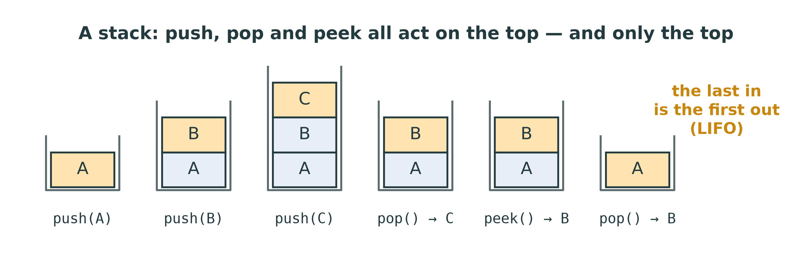
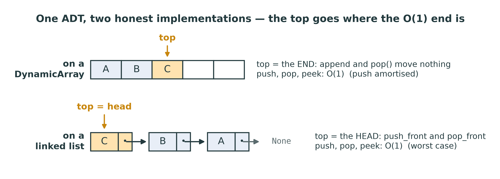
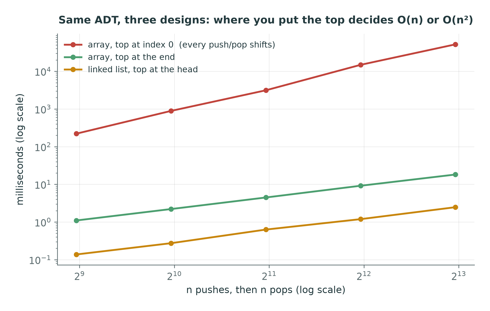
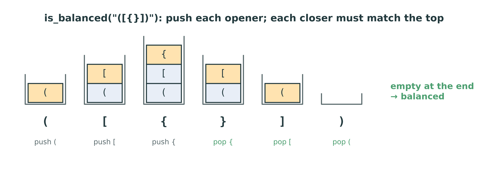
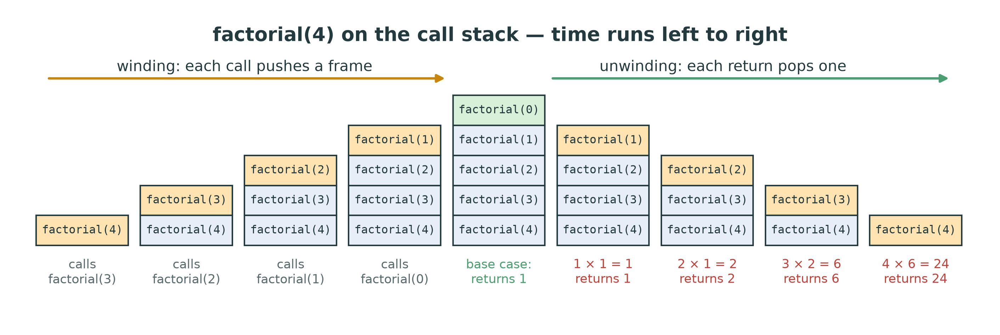

::: {.handout-only}

> **How to read this document.** This is the handout for Lecture 06. It holds
> everything on the slides, plus what I said out loud. The stack is the simplest
> ADT in the course, and one of the most useful: the structure is almost trivial,
> and the interesting part is what you *do* with it. It is also the first time
> you choose between the two structures of Weeks 4 and 5.
>
> Slides: `DSA27-L06-slides.pdf` · Code: `dsa/stack.py` ·
> Tests: `tests/test_stack_queue.py` (the stack half) ·
> Interactive demo: [Stack Lab](https://helghareeb.github.io/DSA27/lectures/06-stacks/stack-lab.html) ·
> Practise online: [Week 6 quiz and written practice](https://helghareeb.github.io/en/quizzes/dsa27/week-06/) (in [Arabic](https://helghareeb.github.io/ar/quizzes/dsa27/week-06/)) ·
> [timed Lecture 6 test](https://helghareeb.github.io/en/quizzes/dsa27/midterm/#lecture=6) ·
> [midterm simulator](https://helghareeb.github.io/en/quizzes/dsa27/midterm/)

:::

# Where We Are

## Two structures, one question

Week 4: the **dynamic array** — cheap at the **end**.
Week 5: the **linked list** — cheap at the **front**.

Today: an ADT that only ever touches **one end** — so either structure can keep
its target of $O(1)$ per operation (amortised for array push). Which, and how?

::: {.handout-only}

Lecture 01 separated the **ADT** — the contract — from the **data structure**
that keeps it, and promised that choosing between structures is the engineering.
This is the first week you do that choice for real, with two structures you have
built yourself.

*Stack* in Arabic: المكدس.

:::

## Today

1. The Stack ADT: push, pop, peek — LIFO
2. Two honest implementations, and one dishonest one
3. Balanced brackets
4. Postfix: expressions without parentheses
5. Infix to postfix: the shunting-yard algorithm
6. The stack you have used all term: the call stack

# The Stack ADT

## Last in, first out

{width=70%}

| Operation | Meaning | Cost |
|---|---|---|
| `push(x)` | put x on top | $O(1)$ amortised for a dynamic array |
| `pop()` | remove and return the top — `IndexError` if empty | $O(1)$ |
| `peek()` | return the top without removing it — `IndexError` if empty | $O(1)$ |
| `is_empty()`, `len(s)` | | $O(1)$ |

::: {.handout-only}

The operations and their meanings define the ADT. The cost column gives our
implementation targets; an ADT alone does not guarantee a running time. Everything a stack can do happens at one end, the **top**. There is
no indexing, no search, no access to the middle, by design: a restriction that
turns out to be exactly what a surprising number of problems need.

Everyday stacks: a pile of plates; the *Undo* history of an editor (the last edit
is the first undone); the *Back* button of a browser; and, most important for us,
the call stack of Lecture 03.

**Empty stacks.** Popping or peeking an empty stack is an error, and the
contract says which one: `IndexError`, like `list.pop()` on an empty list. The
tests check it. Returning `None` instead would be worse than an error: a `None`
can travel a long way through a program before anyone notices.

:::

# Two Honest Implementations

## The top goes where the $O(1)$ end is

{width=96%}

- On a **dynamic array**: top = the **end**. `append` and `pop()`; no shifting, but a growing append may copy.
- On a **linked list**: top = the **head**. `push_front` and `pop_front`.

::: {.handout-only}

Both meet the targets: array push is amortised $O(1)$; the other listed
operations are worst-case $O(1)$ in these course implementations. They differ in the
details that Weeks 4 and 5 taught you to see:

| | Array, top at end | Linked list, top at head |
|---|---|---|
| push | **amortised** $O(1)$ — the occasional resize copies | $O(1)$ worst case |
| pop, peek | $O(1)$ | $O(1)$ |
| memory per item | one reference (+ spare capacity) | a node with value and next references (size depends on Python) |
| memory locality | contiguous | scattered |

`dsa/stack.py` uses the first: `self._items` is your own `DynamicArray` from
Week 4. That is the storage rule from Lecture 02 at work — a structure built on a
structure you built — and it means a bug in last week's `DynamicArray` shows up
in this week's `Stack`.

:::

## …and one dishonest one

Put the top at **index 0** of an array, and **every** push and pop shifts the
whole stack: $O(n)$ each.

{width=76%}

::: {.handout-only}

Real timings of n pushes followed by n pops, on reference implementations. The
two honest designs grow linearly — one unit of slope on the log–log plot, $O(n)$
for n operations, $O(1)$ each. The top-at-index-0 design has twice the slope:
$O(n^2)$ in total. At n = 8,192 that is roughly 50 seconds against a few
milliseconds.

The two honest lines are not on top of each other: here the linked version is
faster, because every access to the course `Array` goes through a Python-level
bounds check (`dsa/array.py`), while a node's `next` is a plain attribute. That is
a constant factor — the thing Big-O ignores and measurement shows. Python's own
`list`, whose checks run in C, would beat both.

Same ADT, same interface, same tests pass — and one design is quadratic. The
tests check *what* your stack does. Only you can check *how*.

:::

# Application 1: Balanced Brackets

## Every closer must match the most recent opener

{width=96%}

- **Opener** `( [ {`: push it.
- **Closer** `) ] }`: the stack must be **non-empty**, and the popped opener must
  be its **partner**.
- **End of text**: the stack must be **empty**.
- Anything else: ignore.

::: {.handout-only}

Why a stack? Because the rule is "the most recently opened bracket must close
first" — last in, first out. `([)]` fails exactly because `)` arrives while the
most recent opener is `[`.

The three ways to be unbalanced correspond to the three checks:

| Input | What happens | Which check |
|---|---|---|
| `([)]` | `)` pops `[` — not its partner | the partner check |
| `)` | a closer arrives with the stack empty | the non-empty check |
| `(` | the text ends with `(` still on the stack | the empty-at-the-end check |

Forgetting any one of them passes most tests and fails one. That is precisely
what `tests/test_stack_queue.py::test_is_balanced` is built to catch — read its
cases before you write the function.

The cost: every character is looked at once, and each push and pop is $O(1)$:
$O(n)$ time, and $O(n)$ space in the worst case (`((((…`).

The invariant: the stack contains exactly the unmatched opening brackets, in
opening order. Its top is the only opener the next closer may match.

| Character in `(a[b])` | Action | Stack, bottom → top |
|---|---|---|
| `(` | push | `(` |
| `a` | ignore | `(` |
| `[` | push | `( [` |
| `b` | ignore | `( [` |
| `]` | pop matching `[` | `(` |
| `)` | pop matching `(` | empty |
| end | accept | empty |

**Check understanding:** `([)]` has equal numbers of openers and closers.
Why is counting not enough? The nesting order is wrong.

This is a model of delimiter matching, not a complete source-code or HTML
parser. A real language must handle strings and comments first; a parenthesis
inside a string need not be a delimiter. Tag matching uses a similar idea,
but HTML also has void elements, optional end tags and other parsing rules.

:::

# Application 2: Postfix

## Expressions with no parentheses

| Infix (usual) | Postfix (reverse Polish) |
|---|---|
| `3 + 4` | `3 4 +` |
| `3 + 4 * 2` | `3 4 2 * +` |
| `(3 + 4) * 2` | `3 4 + 2 *` |
| `8 - 3 - 2` | `8 3 - 2 -` |

In **postfix**, each operator comes **after** its operands. No parentheses, no
precedence rules — the order says everything.

::: {.handout-only}

Postfix notation was introduced by the Australian philosopher and computer
scientist Charles Hamblin in the 1950s, building on the prefix ("Polish")
notation of the logician Jan Łukasiewicz — hence *reverse Polish notation*, RPN.
Hewlett-Packard calculators used it for decades, and the Java and Python virtual
machines are essentially postfix machines: they run a stack of operands.

Compare the second and third rows. In infix, the parentheses change the meaning.
In postfix, the *order* of the tokens carries that meaning instead, so no
parentheses are needed at all.

:::

## Evaluating postfix with one stack

- **Number:** push it.
- **Binary operator:** require two values; pop **right**, then **left**;
  push `left op right`.
- **End:** exactly one value is left — the answer.

| Token | Action | Stack (top on the right) |
|---|---|---|
| `3` | push | 3 |
| `4` | push | 3 4 |
| `2` | push | 3 4 2 |
| `*` | pop 2 and 4, push 8 | 3 8 |
| `+` | pop 8 and 3, push 11 | 11 |

::: {.handout-only}

**The operand order trap.** For `8 3 -`, the first value popped is 3 and the second
is 8, and the answer is `8 - 3` — **second popped minus first popped**. Get it the
wrong way round and addition and multiplication still work (they commute), while
subtraction and division silently give wrong answers. A test with `-` or `/` is
the only thing that catches it.

**Malformed input.** Require two values before each binary operator and
**exactly one** value at the end: use `len(values) != 1`, not just `> 1`.
Raise `ValueError` for malformed input, including an empty expression or an
unrecognised token. Division by zero raises `ZeroDivisionError`. Here `/` is
true division: `7 2 /` gives `3.5`.

| Postfix tokens | Result or reason for rejection |
|---|---|
| `8 3 - 2 -` | `(8 - 3) - 2 = 3` |
| `8 2 /` | `8 / 2 = 4`, not `2 / 8` |
| empty | no final value |
| `3 +` | `+` has only one operand |
| `3 4` | two values remain |

The stack holds values of subexpressions already evaluated, not operators.
Read `12 3 +` as three **tokens**, not individual characters.

This is `evaluate_postfix` in `dsa/translation.py` — an exercise for Week 15,
where the whole calculator comes together. You can write it now: it needs only
this week's stack. $O(n)$ time and $O(n)$ worst-case auxiliary space,
for $n$ tokens under the usual constant-cost arithmetic model.

:::

# Application 3: Infix to Postfix

## The shunting-yard algorithm

For valid expressions with **binary**, left-associative `+ - * /`, read
**tokens** left to right with an **output list** and an **operator stack**:

1. **Number** → output.
2. **Operator** → first pop to the output every operator on the stack with
   **higher or equal precedence**, stopping at a `(`; then push this one.
3. **`(`** → push.
4. **`)`** → pop to the output until the `(`; discard the `(`.
5. **End** → pop remaining operators to the output; parentheses never go there.

Precedence: `*` `/` above `+` `-`. The output is postfix **tokens**, not a value.

::: {.handout-only}

**Input contract.** The Week 6 converter and reference solution assume valid
infix token sequences. `"( 3 + 4 ) * 2".split()` works because the tokens are
space-separated; `"(3+4)*2".split()` does not tokenize the expression. Week 15's
`tokenize` handles that job. Unary minus (`- 5`) and exponentiation are outside
this converter's scope; the recursive parser later supports unary minus.

**Validation extension, not a claim about the current solution:** reject `)`
if no matching `(` exists, and reject any `(` left at the end. Also track
whether an operand or an operator is expected to reject `3 +`, `3 4`, `()` and
`3 + * 4`. Matching parentheses alone does not validate an expression.

Edsger Dijkstra described this algorithm in 1961, and named it after a railway
shunting yard: numbers go straight through the junction, while operators wait on
a siding — the stack — until it is their turn.

The idea: an operator must wait until its right operand has been output. It can
leave the siding only when a *later* operator of lower or equal precedence
arrives (which means its operand is complete), or a `)` closes its group, or the
input ends.

**Equal precedence** pops too — that is what makes `-` and `/` **left
associative**: `8 - 3 - 2` means `(8 - 3) - 2`. When the second `-` arrives, the
first `-` (equal precedence) is popped to the output first, giving `8 3 - 2 -`.
(An operator like `**`, which is right associative, pops only on strictly higher
precedence. The exercise does not include it.)

:::

## Trace: `3 + 4 * 2`

Stack top is on the right; `—` means empty.

| Token | Output | Operator stack |
|---|---|---|
| `3` | `3` | — |
| `+` | `3` | `+` |
| `4` | `3 4` | `+` |
| `*` | `3 4` | `+ *` |
| `2` | `3 4 2` | `+ *` |
| end | `3 4 2 * +` | — |

`+` stays when `*` arrives: it has lower precedence.

## Trace: `( 3 + 4 ) * 2`

| Token | Output | Operator stack, top right |
|---|---|---|
| `(` | — | `(` |
| `3` | `3` | `(` |
| `+` | `3` | `( +` |
| `4` | `3 4` | `( +` |
| `)` | `3 4 +` | — |
| `*` | `3 4 +` | `*` |
| `2` | `3 4 + 2` | `*` |
| end | `3 4 + 2 *` | — |

## Trace: equal precedence in `8 - 3 - 2`

| Token | Output | Operator stack, top right |
|---|---|---|
| `8` | `8` | — |
| first `-` | `8` | `-` |
| `3` | `8 3` | `-` |
| second `-` | `8 3 -` | `-` |
| `2` | `8 3 - 2` | `-` |
| end | `8 3 - 2 -` | — |

Pop the old `-` **before** pushing the new one. The answer is `3`, not `7`.

::: {.handout-only}

The first two cases are in `test_infix_to_postfix`; the third is covered by
`test_infix_to_postfix_is_left_associative`. Now trace `2 * 3 + 4`: when `+`
arrives, `*` leaves first. Postfix is `2 3 * 4 +`, giving `10`.

Why is the nested `while` not $O(n^2)$? Each operator enters the stack once and
leaves once over the **whole** scan. Time is $O(n)$ and auxiliary space is $O(n)$.
The conversion stack holds **operators**; the evaluation stack holds **values**.

**The whole calculator.** Infix → (shunting-yard) → postfix → (evaluation) → a
value: two passes, two stacks, $O(n)$, no tree and no recursion. Week 15 builds
the other route — a recursive parser and an expression tree — and compares them.
Declared in the 2013/2014 bylaws as "the principles of language translation", and
this is where it starts.

:::

# Application 4: The Call Stack

## You have been using a stack since Week 3

{width=94%}

In the usual Python call model, a call pushes a frame and returning removes it.
The latest unfinished call resumes first: **LIFO**.

::: {.handout-only}

Lecture 03's figure, seen again: the call stack is a stack of frames, managed by
Python for you. That is why any recursive algorithm can be rewritten with a loop
and an explicit stack — the stack you now know how to build. Week 14 does exactly
that for depth-first search: `dfs` recursive, and `dfs_iterative` with your own
`Stack`. Matching recursive visit order requires pushing neighbours in the
right order; an explicit stack does not automatically preserve it.

A frame stores arguments, local variables and where to resume, not just the
function name. For `factorial(3)`, calls descend through `3 → 2 → 1`; returns
unwind `1 → 2 → 6`, with each caller resuming its pending multiplication.

An example you can write now: summing a finite, acyclic nested list of integers
without recursion. Run it after implementing your `Stack` and `DynamicArray`.

```python
from dsa.stack import Stack

def nested_sum(nested):
    total, pending = 0, Stack([nested])
    while not pending.is_empty():
        item = pending.pop()
        if isinstance(item, list):
            for inner in item:
                pending.push(inner)        # schedule work for later
        else:
            total += item
    return total
```

This is a **work stack**, not a literal copy of Python's call frames. Pushing
children left to right processes them right to left. For integer addition the
sum is unchanged, but visit order matters for printing, side effects and
floating-point rounding. To visit left to right, push children in reverse order.

For `nested_sum([1, [2, 3], 4])`, with the top on the right:

| Popped item | Pending after processing | Total |
|---|---|---|
| `[1, [2, 3], 4]` | `1, [2, 3], 4` | `0` |
| `4` | `1, [2, 3]` | `4` |
| `[2, 3]` | `1, 2, 3` | `4` |
| `3` | `1, 2` | `7` |
| `2` | `1` | `9` |
| `1` | empty | `10` |

This version avoids Python's recursion-depth limit, whose value is configurable
(`sys.getrecursionlimit()`), but it is still limited by available memory.
Each item occurrence is processed once: $O(n)$ time and up to $O(n)$ pending
space. A wide flat list can put many items on this stack even at shallow depth.

**Undo and redo** use two stacks of reversible action records. *Undo* must
actually reverse the action before moving its record to redo; *Redo* reapplies
it before moving the record back. Moving a record alone does not change the
text. Empty undo/redo stacks mean there is nothing to do. A new edit after undo
clears redo, because it starts a different history.

Example: type `A`, type `B` → `AB`; undo → `A`; redo → `AB`.
Undo again, then type `C` → `AC`: the old `B` action must no longer be redoable.

:::

## Watch it run: the Stack Lab

[**Stack Lab**](https://helghareeb.github.io/DSA27/lectures/06-stacks/stack-lab.html) — open it in any browser.

- The code, the variables and the **stack as a pile**, one step at a time
- Push, pop, peek, and a push that **resizes** the `DynamicArray` underneath
- Balanced brackets, postfix evaluation, **shunting-yard**, the whole calculator
- `nested_sum` with your own stack, and undo/redo with two
- *What happens next?* — answer before you step
- Nine scenarios that **go wrong**: top at index 0, a missing bracket check,
  operands swapped, `>` instead of `>=`…

::: {.handout-only}

The Stack Lab is the demo used in the lecture. It runs every algorithm in this
handout, step by step: the line that runs, every variable, and each stack drawn
as a pile with its top up. For the applications it also shows the input with a
cursor on the current token, and the output as it grows. Counters keep the
pushes, pops and shifts, so the top-at-index-0 design shows its cost.

- **Online:** <https://helghareeb.github.io/DSA27/lectures/06-stacks/stack-lab.html>
- **Offline:** open `docs/lectures/06-stacks/stack-lab.html` from your copy of
  the repository. It is a single file and needs no installation.

How to use it:

- Pick a scenario at the top. Change the values, the text or the tokens in the
  `>>>` line and press **Run**.
- **Step** (→) moves one step and **Back** (←) undoes it. **Skip loop** (O)
  runs the rest of a loop in one step; **Step out** (U) finishes the current
  call. **Play** (P) runs on its own.
- At the key moments the demo stops with a question. Answer it (A–D) **before**
  you look; that is where the learning happens.

What to try, in order: push with a resize and the amortised scenario, then the
linked stack and the top-at-index-0 stack side by side; the three unbalanced
inputs `([)]`, `(a))` and `((a)`, each next to the broken version that lets it
through; `8 3 - 2 -` next to the swapped-operand version; `8 - 3 - 2` through
shunting-yard next to the `>` version; then the calculator, `nested_sum` and
undo/redo. For each broken scenario, find the bug in the code **before** you
step.

The stack, bracket and shunting-yard scenarios show code that solves this
week's exercises, and the postfix ones solve `evaluate_postfix` from Week 15.
Write your own version first. The linked stack and the editor were written for
the demo; there is no exercise for them.

:::

# This Week

## Exercises: `dsa/stack.py`

| Function | Target | The trap |
|---|---|---|
| `Stack.push(value)` | $O(1)$ amortised | top at the **end** of `self._items` |
| `Stack.pop()` | $O(1)$ | `IndexError` when empty |
| `Stack.peek()` | $O(1)$ | `IndexError` when empty; do not remove |
| `is_balanced(text)` | $O(n)$ | three checks: partner, non-empty, empty at the end |
| `infix_to_postfix(tokens)` | $O(n)$ | pop on **higher or equal** precedence; `(` and `)` |

```powershell
pytest tests/test_stack_queue.py -v -k "lifo or peek or empty_behaviour or balanced or infix"
```

Your `Stack` stands on your `DynamicArray`: `tests/test_dynamic_array.py` must
pass first.

::: {.handout-only}

`__init__`, `is_empty`, `__len__` and `__repr__` are given. `is_balanced` and
`infix_to_postfix` should use your `Stack` — not a Python list as a stack, which
is what the storage rule forbids for working storage when a structure of yours is
available. Their **result** — the list of output tokens from
`infix_to_postfix` — is a Python list, because that is the interface the tests
use.

Both algorithms are $O(n)$: each token is pushed at most once and popped at most
once.

:::

## Homework 6 — before Lecture 07

1. **Implement** `dsa/stack.py` until the stack tests pass.
2. **Trace** `infix_to_postfix` on `8 - 3 - 2`, `2 * 3 + 4` and
   `( 1 + 2 ) * ( 3 - 4 ) / 5`, as tables. Then evaluate each result by hand
   with the postfix algorithm.
3. **Write** `evaluate_postfix` in `dsa/translation.py` (it only needs your
   `Stack`), and check it against your traces.
4. **Design.** Sketch an undo/redo system for a text editor with two stacks.
   What happens to the redo stack when the user types after undoing?

::: {.handout-only}

For item 3, `pytest tests/test_translation.py -v -k evaluate_postfix` runs just the
postfix tests; the rest of that file belongs to Week 15.

:::

## Practise online

- [**Week 6 quiz**](https://helghareeb.github.io/en/quizzes/dsa27/week-06/): 40 multiple-choice questions, every answer explained
- **Written practice** on the same page: 9 questions. Write, then mark yourself against the marking points
- [**Lecture 6 test**](https://helghareeb.github.io/en/quizzes/dsa27/midterm/#lecture=6): 20 questions, 25 minutes, timed
- [**Midterm simulator**](https://helghareeb.github.io/en/quizzes/dsa27/midterm/): Lectures 1–7, papers of up to 60 questions
- In Arabic: [week 6](https://helghareeb.github.io/ar/quizzes/dsa27/week-06/) · [midterm](https://helghareeb.github.io/ar/quizzes/dsa27/midterm/)

::: {.handout-only}

Everything runs in the browser and keeps your results on your own device.
Do the quiz **after** the homework, as a check, not instead of it: it
shows you which ideas did not stick, and the explanation of each answer
sends you back to the right part of this handout.

- Quiz and written practice: <https://helghareeb.github.io/en/quizzes/dsa27/week-06/>
- Timed test on this lecture: <https://helghareeb.github.io/en/quizzes/dsa27/midterm/#lecture=6>

:::

# Summary

## Seven things to keep

1. A stack is **LIFO**: push, pop and peek act on the **top** only, with array push **amortised** $O(1)$.
2. Empty `pop` and `peek` raise **`IndexError`**.
3. On an array the top is the **end**; on a linked list the **head**. Both honest.
4. Top at index 0 of an array: **$O(n)$** per operation — same tests pass, wrong
   design.
5. **Balanced brackets**: push openers; each closer must match the top; empty at
   the end.
6. **Postfix**: push numbers; an operator pops two — **second popped is the left
   operand**.
7. **Shunting-yard**: before pushing an incoming left-associative operator, pop
   stacked operators of **higher or equal** precedence; also drain at `)` and
   at end, never outputting parentheses.

## Next

**Week 7 — Queues.** First in, first out: the ADT that needs **both** ends — and
the week your `DynamicArray` finally meets an operation it is bad at.

::: {.handout-only}

---

## Sources and further reading

- **E. W. Dijkstra.** "Algol 60 translation: An Algol 60 translator for the X1 and
  making a translator for Algol 60", Mathematisch Centrum report MR 35, 1961 —
  where the shunting-yard algorithm was first described.
- **C. L. Hamblin.** "Translation to and from Polish notation", *The Computer
  Journal* 5(3), 1962 — reverse Polish notation and its evaluation with a stack.
- **M. T. Goodrich, R. Tamassia and M. H. Goldwasser.** *Data Structures and
  Algorithms in Python*, Wiley, 2013, chapter 6, "Stacks, Queues, and Deques" —
  array-based stacks, and bracket and HTML tag matching.
- **T. H. Cormen, C. E. Leiserson, R. L. Rivest and C. Stein.** *Introduction to
  Algorithms*, 3rd ed., MIT Press, 2009, section 10.1, "Stacks and queues".

Every figure in this lecture is generated by `tools/figures_l06.py`; the call
stack figure is Lecture 03's. The timing figure is real measurement and will
differ slightly on your machine.

:::
