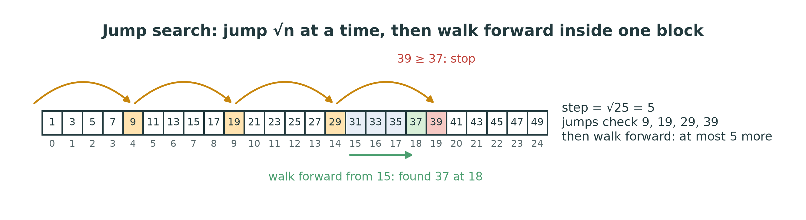
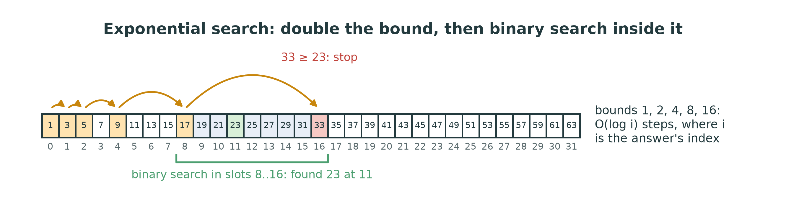
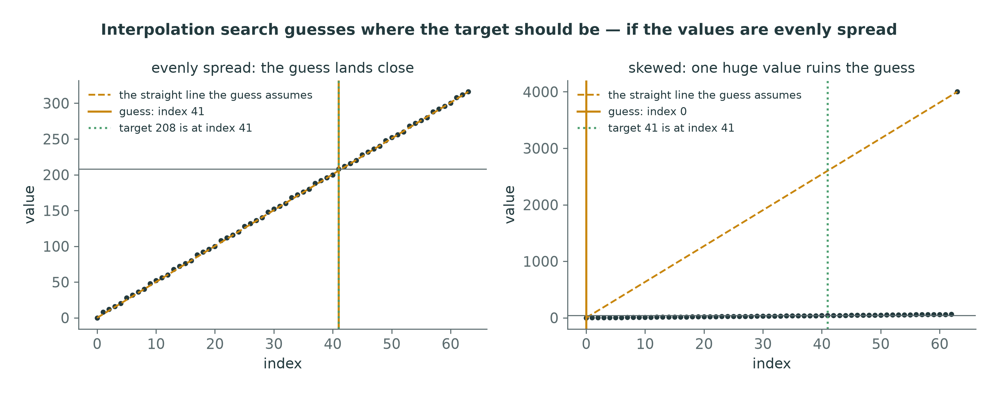
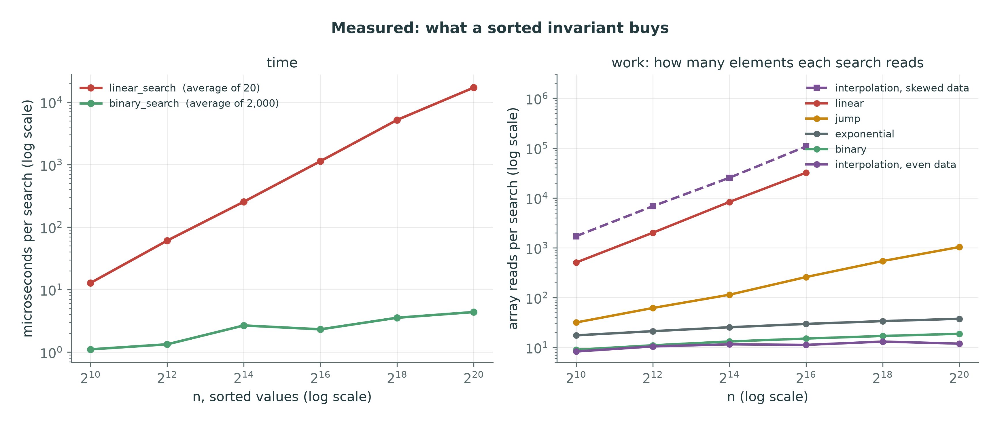

::: {.handout-only}

> **How to use this lecture.** Trace one small array by hand first. Look for a
> match, a miss, and the ends of a run of duplicates. Then replay the steps in
> the [Searching Lab](https://helghareeb.github.io/DSA27/lectures/trace-lab.html#week-08)
> and use the quiz questions beside each topic to check that you can search a
> different array. The later notes give the derivations and the midterm review.
>
> Slides: `DSA27-L08-slides.pdf` · Code: `dsa/searching.py` ·
> Tests: `tests/test_searching.py` ·
> Practise online: [Week 8 quiz and written practice](https://helghareeb.github.io/en/quizzes/dsa27/week-08/) (in [Arabic](https://helghareeb.github.io/ar/quizzes/dsa27/week-08/))

:::

# Where We Are

## From structures to algorithms

Weeks 4–7 built **structures**: dynamic array, linked list, stack, queue.

Weeks 8–10 are about **algorithms** on the simplest of them, the array:

- **Week 8:** find a value — **searching**
- **Weeks 9–10:** put the values in order — **sorting**

Today's question: **what does it buy you to keep an array sorted?**

::: {.handout-only}

Every structure so far had a `find` or an `in`, and every one of them was
$O(n)$: walk until you see the value. This week shows that the walk is
unavoidable only when you know **nothing** about where the value might be. An
array whose values are in increasing order tells you a great deal, and each
search below uses that knowledge in a different way.

*Search* in Arabic: البحث. *Binary search*: البحث الثنائي.

:::

## Today

1. Find the first match by scanning.
2. Use sorted order to discard a range safely.
3. Find the two boundaries of a run of duplicates.
4. Choose a search for the data you have.

## One array, three questions

Keep **`A = [1, 2, 2, 2, 5, 7]`** on the board. Indices start at 0.

| Question | What to report |
|---|---|
| Where is a 2? | A matching index. A first-match search must give 1. |
| Is 4 present? | A search for a value reports `-1`. |
| Where would 4 go? | The insertion position is 4, before 5. |

**Predict:** Is every search for 2 required to return the same index?

# Linear Search

## Look at everything

Scan left to right, stopping at the **first** equal value.

| Search | Indices inspected | Result |
|---|---|---:|
| `linear_search(A, 2)` | 0, 1 | 1 |
| `linear_search(A, 4)` | 0 through 5 | -1 |
| Search for 1 in `[5, 2, 7, 2, 1, 2]` | 0 through 4 | 4 |

The scan works even when the array is unsorted. It makes up to `n`
equality tests and uses constant extra space.

::: {.handout-only}

If the target is present and equally likely to be at any index, the
expected number of equality tests is $(n+1)/2$. One search on an
unsorted array need not pay the cost of sorting. Try **W8-M01** after
the first Searching Lab scenario.

:::

# Binary Search

## Halve what is left

On sorted `A`, the first middle index is 2. Searching for 2 finds
`A[2] == 2` at once. The result **2** is a valid matching index.

**Predict:** Why did the linear search return 1 instead?

::: {.handout-only}

Linear search finds the first match by visiting indices in order.
Ordinary binary search stops at the match it encounters. A later
section finds the first match explicitly with `lower_bound`.

:::

## The algorithm, and the promise it keeps

Keep two indices, `lo` and `hi`: the part still in play is `values[lo..hi]`,
both ends included.

1. `lo = 0`, `hi = n − 1`
2. while `lo <= hi`: `mid = (lo + hi) // 2`
   - `values[mid] == target` → return `mid`
   - `values[mid] < target` → `lo = mid + 1`
   - otherwise → `hi = mid − 1`
3. return −1

**Invariant:** if the target is anywhere, it is in `values[lo..hi]`.

::: {.handout-only}

An **invariant** is a statement that is true before the loop, stays true after
every step, and so is still true when the loop ends. Here: "if the target is in
the array at all, it is between `lo` and `hi`". At the start the range is the
whole array, so it is true. Each step discards only elements that cannot be the
target — everything up to `mid` when `values[mid]` is too small, everything from
`mid` when it is too large — so it stays true. When `lo > hi`, the range is
empty, and the invariant tells you the target is nowhere: return −1.

This is the whole of `binary_search`. The steps are written out here in words
on purpose: turning them into Python, and getting every `+ 1` and `<=` right, is
the exercise.

**A miss on the quiz array V.** Search
`[3, 6, 8, 12, 15, 19, 21, 24, 27, 31, 34, 38, 41, 45, 48, 52]` for 20.
Predict the first two middle indices before attempting **W8-M05 and W8-M06**.

| lo | hi | mid | values[mid] | Decision |
|---|---|---|---|---|
| 0 | 15 | 7 | 24 | 24 > 20 → hi = 6 |
| 0 | 6 | 3 | 12 | 12 < 20 → lo = 4 |
| 4 | 6 | 5 | 19 | 19 < 20 → lo = 6 |
| 6 | 6 | 6 | 21 | 21 > 20 → hi = 5 |
| 6 | 5 | | | lo > hi: return −1 |

Four middle probes, and the loop ends with `lo` = 6: the position where 20
**would be** inserted. That is the idea behind `lower_bound`.

:::

## Trace a binary-search miss

Find 4 in `A`. The interval **includes** both ends.

| lo | hi | mid | A[mid] | Next interval |
|---:|---:|---:|---:|---|
| 0 | 5 | 2 | 2 | `[3, 5]` |
| 3 | 5 | 4 | 5 | `[3, 3]` |
| 3 | 3 | 3 | 2 | empty, since `lo = 4` and `hi = 3` |

**Predict:** When `lo == hi == 3`, is that interval empty?

::: {.handout-only}

There is one last candidate. Check it, then return `-1` when the interval
is empty. At each step, keeping only the chosen half preserves the invariant
because every discarded value is either too small or too large. Reproduce
the trace in the lab, then give the invariant in **W8-M07 and W8-E1**.

:::

## The sorted-order promise

Now try the same binary-search rule for 1 on `[5, 2, 7, 2, 1, 2]`.
Index 2 holds 7, so the rule discards the right side, where 1 actually sits.

**Check:** The search returns `-1` even though index 4 holds 1.

::: {.handout-only}

The function assumes sorted input and does not spend a linear pass checking
it. Explain why a quiet wrong result is possible in **W8-M04**.

:::

## How many probes?

Here one **probe** means inspecting one middle element and deciding which way
to go. Python may evaluate both `==` and `<` in that probe; the table counts
probes, not individual Boolean operators.

Each unsuccessful probe leaves at most half the candidates. For $n \ge 1$,
the worst case is $\lfloor \log_2 n \rfloor + 1$ probes.

| n | At most this many middle positions inspected |
|---|---|
| 1,000 | 10 |
| 1,000,000 | 20 |
| 1,000,000,000 | 30 |

Binary search takes **$O(\log n)$** time and the loop uses $O(1)$ extra
space. Use the table to explain **W8-M02 and W8-M03**.

::: {.handout-only}

Why $\lfloor \log_2 n \rfloor + 1$: the range starts with n elements, and a
comparison that does not find the target leaves at most half of them (rounded
down). After $\lfloor \log_2 n \rfloor$ such halvings one element is left, and
one more comparison settles it. For the 16 values above, $\log_2 16 = 4$, so at
most 5: searching for 52, the last value, takes exactly 5.

The recurrence, in the language of Lecture 03: $T(n) = T(n/2) + O(1)$, which
solves to $O(\log n)$. Space: $O(1)$ for the loop — just `lo`, `hi` and `mid`.

`test_binary_search_does_not_scan_linearly` searches a list of a million
integers. A correct binary search reads 20 of them. An accidental linear scan
somewhere in your function reads a million and the test becomes slow — which is
the point of the test.

:::

## The last candidate can be the answer

Search `A` for **7**. The first two probes leave `lo = hi = 5`.

| Loop condition | What happens next |
|---|---|
| `lo <= hi` | Probe index 5 and find 7. |
| `lo < hi` | Exit before checking 7. |

**Predict:** Which condition would you use if the right endpoint
were excluded? Compare the two contracts in **W8-M08 and W8-E2**.

# Bounds: Searching for Positions

## `lower_bound` and `upper_bound`

Both functions find a **boundary position** in a sorted array.

| Function | First position whose value is | At equality |
|---|---|---|
| `lower_bound` | at least the target | Keep the left portion |
| `upper_bound` | greater than the target | Continue to the right |

Start with `[lo, hi) = [0, len(A))`. The right endpoint is excluded.
Keep going while `lo < hi`, then return the point where they meet.

::: {.handout-only}

Elements before `lo` fail the chosen comparison and those at or beyond
`hi` satisfy it, where those indices exist. If all items fail, the
boundary is `len(A)`. It is a valid insertion position and cannot be
read as an array element. To check for the first occurrence, test
`i < len(A)` before testing `A[i] == target`.

Python's `bisect_left` and `bisect_right` give these boundaries. Insertion,
counting duplicates and counting an interval are three uses to explain
in **W8-M16 and W8-E3**.

:::

## Trace both bounds on the run of 2s

| Search | Intervals in order | Result |
|---|---|---:|
| Lower bound of 2 | `[0, 6) → [0, 3) → [0, 1) → [1, 1)` | 1 |
| Upper bound of 2 | `[0, 6) → [4, 6) → [4, 5) → [4, 4)` | 4 |

The run is `A[1:4]`. Its length is **4 − 1 = 3**.

**Predict:** What does `lower_bound(A, 8)` return?

::: {.handout-only}

It returns 6, so 8 belongs after the final element. If the two
bounds are equal, the target has zero copies. Use the same difference
`lower_bound(A, b) - lower_bound(A, a)` for the number of values
in the value interval `[a, b)`. Work **W8-M12 through W8-M15** and
write out the middle indices for **W8-T2**.

:::

# Three More Searches

## Jump search: $O(\sqrt{n})$

{width=96%}

Inspect the ends of blocks of size **√n** until the end reaches or passes
the target. Then scan inside that block.

::: {.handout-only}

With blocks of size m, there are at most n/m jumps and then at most m steps
inside a block: about $n/m + m$ reads. That sum is smallest when $m = \sqrt{n}$,
giving $2\sqrt{n}$ — for a million elements, about 2,000 reads against 20 for
binary search. Slower. So why bother?

The jumps inspect increasing block ends, but the final scan returns to the
**start of the candidate block**. This is not a forward-only algorithm for a
one-pass stream: it assumes indexed access, or that the candidate block can be
buffered and revisited. On an ordinary random-access array, binary search uses
fewer probes asymptotically. Jump search is useful here as a clear example of
balancing two costs, $n/m$ and $m$.

In the figure, n = 25 and the step is $\sqrt{25} = 5$. The jumps check slots 4,
9, 14 and 19 — the last element of each block — and stop at 39, the first block
end that is not smaller than 37. The walk goes forward from slot 15 and finds 37
at slot 18. (`math.isqrt(n)` gives the integer square root.)

:::

## Exponential search: $O(\log(i+2))$

{width=96%}

After checking slot 0, inspect slots 1, 2, 4, 8, … until a value reaches or
passes the target, or the next index falls beyond the array. Then binary
search between the last two bounds, with the right end capped at the end.

::: {.handout-only}

If the answer is at index i, the doubling stops after about $\log_2 i$ steps,
and the binary search that follows runs on a range of about i elements:
$O(\log(i+2))$ in total. When the target is near the **front**, that beats a
binary search over the whole array; when it is near the end, it costs about
twice as much. In the figure, 23 is at index 11: the bounds 1, 2, 4 and 8 are
all smaller, 16 is not, so binary search runs on slots 8 to 16.

Doubling also works when no upper index is given, provided you can look
up values by index and detect the end of a finite sequence. The course
function uses `len(values)` to check the bounds explicitly. Bentley and
Yao published the unbounded-search idea in 1976. Doubling is also the
growth strategy from Lecture 04.

Watch the edge cases: check slot 0 first (the doubling starts at 1), and do not
let the bound run past `len(values) - 1`.

:::

## Interpolation search: guess, don't halve

{width=94%}

$$\text{pos} = \text{lo} + \frac{(\text{target} - v[\text{lo}])\,(\text{hi} - \text{lo})}{v[\text{hi}] - v[\text{lo}]}$$

Roughly uniform numeric data: $O(\log \log n)$ on average in the uniform
model. Skewed data can take **$O(n)$**.

::: {.handout-only}

Looking up "Zaki" in a phone book, you do not open it in the middle: you open it
near the end, because Z is near the end of the alphabet. Interpolation search
does exactly that. It assumes the values rise in a straight line from `v[lo]` to
`v[hi]` and computes where the target would sit on that line. On evenly spread
values the guess is very close, and the range shrinks so fast that the expected
number of steps is $O(\log \log n)$ — about 4 or 5 for a million elements,
against 20 for binary search. (The idea is W. W. Peterson's, 1957; the
$\log \log n$ analysis is by Perl, Itai and Avni, 1978.)

The price is the **worst case**. In the right-hand panel, one huge value at the
end makes the straight line useless: every guess lands at the far left, the
range shrinks by one element per step, and the search becomes a slow linear
scan — $O(n)$. That is the docstring's warning: an average case that hides a bad
worst case.

Three traps in the code, which the tests on one element and on random data
catch:

- **Division by zero** when `v[hi] == v[lo]`: handle that range separately.
- **A guess outside the range** when the target is smaller than `v[lo]` or
  larger than `v[hi]`: stop at once — it is not there.
- **Integer division**: the position must be an `int` index. Use `//`.

:::

## Choose what to probe next

| Method | Worked search | What to inspect |
|---|---|---|
| Jump | 37 in the first 25 odd numbers | Block ends 4, 9, 14, 19. Then scan 15 through 18. |
| Exponential | 23 in the same array | After index 0, try 1, 2, 4, 8, 16. Then bisect 8 through 16. |
| Interpolation | 70 in `[10, 20, ..., 100]` | The distance between the endpoint values puts the first guess at index 6. |

**Predict:** Which method needs values that behave like numbers and
benefits from even spacing? Practise **W8-M17 through W8-M22**.

# Measured

## Eight functions, one picture

{width=96%}

::: {.handout-only}

**Left: time.** On a million sorted integers, a linear search took about 17
milliseconds and a binary search about 4 **microseconds** — some four thousand
times faster, and the gap doubles every time n doubles. The binary line is not
perfectly smooth: at these tiny times, memory caches and timer noise show. Its
rise over the whole range, from 1 to about 4 µs while n grew a thousandfold, is
the logarithm.

**Right: work** — how many elements each search reads, on average, counted
exactly by passing the searches a sequence that counts every `values[i]`. The
counts come from the reference implementation, and yours may differ by a small
constant factor.

- **Linear:** about n/2 reads — slope 1 on the log–log plot.
- **Jump:** about √n reads — slope ½. 1,035 reads at n = 2^20^, where
  √n = 1,024.
- **Binary:** 18.8 reads at n = 2^20^, where $\log_2 n = 20$.
- **Exponential:** about twice binary, since it doubles up to the target and
  then binary searches a range as big again — 37.5 at n = 2^20^.
- **Interpolation, even data:** flat at about 12 reads — about four steps of
  three reads each ($v[\text{lo}]$, $v[\text{hi}]$ and the guess), at every size.
  $\log \log n$ is as close to constant as a growing function gets.
- **Interpolation, skewed data:** more than 100,000 reads at n = 65,536 —
  **three times worse than linear search**, because each of its roughly n/2
  one-slot steps reads three values.

The four searches on sorted data all pass the same tests. Measurement is what
tells them apart.

:::

## When is sorting first worth it?

| Searches on one fixed array | Cost model |
|---|---|
| Scan each time | $O(kn)$ for $k$ searches |
| Sort once and then bisect | $O(n \log n + k \log n)$ |

**Predict:** If you need only one result from an unsorted array, why
pay to sort the entire array first?

::: {.handout-only}

For a million elements, a full scan can inspect a million positions;
a binary search uses at most 20 probes after sorting. A comparison sort
has work on the scale of 20 million comparisons. These figures explain
the roughly logarithmic break-even scale in **W8-E5**. Real timing
depends on the sort, the data, and how often scans stop early.

The cost table assumes the data stay fixed. If you need original
indices, carry those indices as you sort. If you insert a new value
at its lower bound, finding the position is logarithmic, but shifting
the array can still take linear time.

:::

## The eight functions

| Function | Needs | Time | Note |
|-----------------------------------|------------|----------------------|-------------------------|
| `linear_search` | nothing | $O(n)$ | first match |
| `binary_search` | sorted | $O(\log n)$ | loop, $O(1)$ space |
| `binary_search_recursive` | sorted | $O(\log n)$ | $O(\log n)$ stack; never slice |
| `lower_bound` | sorted | $O(\log n)$ | first `v[i] >= x`; may be `len` |
| `upper_bound` | sorted | $O(\log n)$ | first `v[i] > x`; may be `len` |
| `jump_search` | sorted | $O(\sqrt{n})$ | revisit candidate block |
| `exponential_search` | sorted | $O(\log(i+2))$ | useful near the front |
| `interpolation_search` | sorted numbers | $O(\log \log n)$ uniform avg, $O(n)$ worst | guesses |

## Watch it run: the Searching Lab

- Scan the unsorted example and see why a binary-search shortcut can fail.
- Test a miss and a last-position hit. Then find both ends of the duplicate run.
- Compare jump, exponential and interpolation probes before choosing a method.

[Open the Searching Lab](https://helghareeb.github.io/DSA27/lectures/trace-lab.html#week-08)

# This Week

## Exercises: `dsa/searching.py`

| Function | The trap |
|---|---|
| `linear_search` | unsorted input; return the **first** match |
| `binary_search` | `lo <= hi`; `mid ± 1`; −1 when missing |
| `binary_search_recursive` | pass `lo`, `hi`; **no slices** |
| `lower_bound`, `upper_bound` | half-open `[lo, hi)`; `>=` against `>` |
| `jump_search` | `math.isqrt`; the last, partial block |
| `exponential_search` | slot 0 first; bound capped at `len − 1` |
| `interpolation_search` | equal ends; target outside `[v[lo], v[hi]]` |

```powershell
pytest tests/test_searching.py -v
```

::: {.handout-only}

The four searches on sorted data are run against the same cases —
found, missing, empty, one element, first, last — and against linear search on
30 random sorted lists (`test_agrees_with_linear_search_on_random_data`, with a
fixed seed so a failure is repeatable). The values in those tests are distinct,
so "any matching index" and "the first matching index" agree.

The functions take Python lists as **input**, which the storage rule allows:
they only read them and store nothing.

:::

## Homework 8 — before Lecture 09

1. **Implement** `dsa/searching.py` until the searching tests pass.
2. **Trace** `binary_search` on `[2, 5, 8, 12, 16, 23, 38, 56, 72, 91]` for 23
   and for 60, as tables of `lo`, `hi`, `mid`.
3. **Measure** linear against binary search in `notebooks/08-searching.ipynb`,
   and count reads with a counting sequence, as in the figure.
4. **Break it.** Change `lo <= hi` to `lo < hi` in your `binary_search`. Which
   tests fail, and why exactly those?

::: {.handout-only}

For item 3, the counting sequence is a class with `__len__` and a `__getitem__`
that adds 1 to a counter before returning `self.values[i]`; your searches cannot
tell it from a list. `tools/figures_l08.py` has one, `CountingReads`.

For item 4, predict before you run: which **positions** can a `lo < hi` search
never examine?

:::

## Practise online

- [**Week 8 quiz**](https://helghareeb.github.io/en/quizzes/dsa27/week-08/): 22 multiple-choice questions, every answer explained
- **Written practice** on the same page: 5 questions. Write, then mark yourself against the marking points
- In Arabic: [week 8](https://helghareeb.github.io/ar/quizzes/dsa27/week-08/)

::: {.handout-only}

Everything runs in the browser and keeps your results on your own device.
Do the quiz **after** the homework, as a check, not instead of it: it
shows you which ideas did not stick, and the explanation of each answer
sends you back to the right part of this handout.

- Quiz and written practice: <https://helghareeb.github.io/en/quizzes/dsa27/week-08/>

:::

# Implementation Notes and Deeper Analysis

## Reference for the lab

Use the later handout sections for implementation details and derivations after tracing the worked examples.

::: {.handout-only}

## Easy to state, hard to get right

- `while lo < hi` with an inclusive `hi` → **misses** the last candidate.
- `hi = mid` with an inclusive `hi` → can **loop for ever**.
- `lo = mid` → can **loop for ever** when `hi = lo + 1`.
- `mid = (lo + hi) / 2` in Java or C → **overflows** when `lo + hi` exceeds the
  largest `int`.


Binary search has a famous history of being wrong. Knuth records that the first
binary search was published in 1946, and the first that works correctly for
**every** n not until 1962 (*TAOCP* vol. 3, §6.2.1). Jon Bentley gave the
problem to professional programmers in courses at Bell Labs and IBM, with two
hours to write it: about ninety percent of the programs had bugs
(*Programming Pearls*, column 4). And in 2006 Joshua Bloch reported that the
binary search in Java's own library — `java.util.Arrays.binarySearch`, which
he had written himself — failed on arrays of more than about a billion
elements, because `(low + high) / 2` overflowed a 32-bit `int`. The fix is
`low + (high - low) / 2`. The bug had been in the library for nine years.

Python integers do not overflow, so the last bug cannot happen here — but you
will write binary search in C or Java one day, so name it now.

The other three bugs have one cure: **decide what `lo` and `hi` mean, and keep
every line faithful to it.** With `hi` inclusive (the range is `values[lo..hi]`),
the loop runs while the range is non-empty, `lo <= hi`, and both updates must
move past `mid`, because `mid` has just been ruled out. The infinite loops happen
when an update does not move: with `lo = 5`, `hi = 6`, `mid` is 5, and `lo = mid`
leaves everything as it was. Test the sizes 0, 1 and 2 by hand: nearly every
binary-search bug shows up on one of them. The tests check the empty list and
one element (`test_handles_empty_and_single_element`), and the first and last
positions (`test_finds_first_and_last_element`).

## Recursive binary search

Same idea: search the half that can hold the target, **by a call**.

- $O(\log n)$ time, but also **$O(\log n)$ stack** — the loop is $O(1)$ space.
- Pass `lo` and `hi` down. **Never slice**: `values[mid + 1:]` copies — $O(n)$
  per call.


`binary_search_recursive(values, target, lo=0, hi=None)` keeps the same
contract. The base case is the empty range, `lo > hi`: return −1. `hi=None` is
the usual trick for a default that depends on another argument: the first call
replaces it with `len(values) - 1`.

**The slicing trap.** A recursive search that calls itself on
`values[:mid]` or `values[mid + 1:]` looks elegant and is wrong twice. It is
slow: each slice copies up to n/2 elements, so the total is
$n/2 + n/4 + \dots = O(n)$ — as slow as a linear search, while looking like a
binary one. And it loses the position: the index returned by a call on a slice
is an index into the slice, not into the original list, so every call on a right
half must add an offset. Passing `lo` and `hi` avoids both problems. (Lecture 03
made the same point about `list_max` on slices.)

The depth is at most about $\log_2 n$ frames — 20 for a million elements — so
Python's configured recursion limit is usually no concern here, unlike the linear recursions of
Lecture 03. The loop is still the better tool: same speed, no frames at all.

## Midterm review for Weeks 1–7

Weeks 1–7 are examinable. For each week, can you:

- **1–2:** define an ADT; give Θ of a loop; prove a Big-O bound?
- **3:** write a recurrence and trace a call stack?
- **4:** explain amortised $O(1)$ append?
- **5–7:** draw a linked list, stack, queue or ring **after every operation**?

The [mock exam for weeks 1–7](../../question-bank/mock-exam-weeks01-07.md) is in
the question bank.


Use this Weeks 1–7 checklist for revision. Work the question banks before
checking the answers, and time yourself on a mock. Lecture 08 is separate
from that review. Its quiz and written practice prepare you for Searching
on the final.

## Train for the midterm online

The [midterm simulator](https://helghareeb.github.io/en/quizzes/dsa27/midterm/) draws a new paper from the bank every time:

- [Full midterm](https://helghareeb.github.io/en/quizzes/dsa27/midterm/#paper=full) — 60 questions, 90 min
- [Exam format](https://helghareeb.github.io/en/quizzes/dsa27/midterm/#paper=format) — 30 questions + 30 marks written, 2 h
- [Half paper](https://helghareeb.github.io/en/quizzes/dsa27/midterm/#paper=half) — 30 questions, 45 min
- [Explain-level challenge](https://helghareeb.github.io/en/quizzes/dsa27/midterm/#paper=why) — 25 "why" questions
- [My weak spots](https://helghareeb.github.io/en/quizzes/dsa27/midterm/#paper=weak) · [My mistakes](https://helghareeb.github.io/en/quizzes/dsa27/midterm/#paper=wrongs)
- One lecture, 20 questions: [1](https://helghareeb.github.io/en/quizzes/dsa27/midterm/#lecture=1) · [2](https://helghareeb.github.io/en/quizzes/dsa27/midterm/#lecture=2) · [3](https://helghareeb.github.io/en/quizzes/dsa27/midterm/#lecture=3) · [4](https://helghareeb.github.io/en/quizzes/dsa27/midterm/#lecture=4) · [5](https://helghareeb.github.io/en/quizzes/dsa27/midterm/#lecture=5) · [6](https://helghareeb.github.io/en/quizzes/dsa27/midterm/#lecture=6) · [7](https://helghareeb.github.io/en/quizzes/dsa27/midterm/#lecture=7)

On paper: [mock exam, weeks 1–7](../../question-bank/mock-exam-weeks01-07.md) and
[mock exam B](../../question-bank/mock-exam-b-weeks01-07.md), with its own
[answers](../../question-bank/mock-exam-b-weeks01-07-answers.md).


The same page in Arabic: <https://helghareeb.github.io/ar/quizzes/dsa27/midterm/>. Each link above opens the simulator with
that paper already chosen, so you can bookmark it or share it with your group;
add `&code=ABC123` (any letters and digits) to a link and everyone who opens it
gets the same paper.

:::

# Summary

## Seven things to keep

1. Linear search needs no order and costs **$O(n)$**.
2. Binary search needs **sorted** data and costs **$O(\log n)$**: at most
   20 middle probes for a million.
3. Its invariant: if the target is anywhere, it is in `values[lo..hi]`.
4. Get the boundaries right: `lo <= hi`, `mid ± 1` — test sizes 0, 1, 2.
5. Recursive: pass `lo` and `hi`; a slice turns $O(\log n)$ into $O(n)$.
6. `lower_bound`/`upper_bound` return **positions**: insertion points and
   counts of duplicates.
7. Jump $O(\sqrt{n})$, exponential $O(\log(i+2))$, interpolation
   $O(\log \log n)$ average but **$O(n)$ worst**.

## Next

**Week 9 — Basic sorting.** Bubble, selection and insertion sort — and counting
sort, which can be linear for a small key range because it does not determine
order through comparisons between keys.

::: {.handout-only}

---

## Sources and further reading

- **D. E. Knuth.** *The Art of Computer Programming*, vol. 3, *Sorting and
  Searching*, 2nd ed., Addison-Wesley, 1998, §6.1 "Sequential searching" and
  §6.2.1 "Searching an ordered table" — binary search, its history, and
  interpolation search.
- **J. Bentley.** *Programming Pearls*, 2nd ed., Addison-Wesley, 1999, column 4,
  "Writing correct programs" — binary search, invariants, and the programmers
  who got it wrong.
- **J. Bloch.** "Extra, Extra — Read All About It: Nearly All Binary Searches
  and Mergesorts are Broken", Google Research Blog, 2 June 2006.
- **J. L. Bentley and A. C. Yao.** "An almost optimal algorithm for unbounded
  searching", *Information Processing Letters* 5(3), 1976 — exponential search.
- **Y. Perl, A. Itai and H. Avni.** "Interpolation search — a log log N search",
  *Communications of the ACM* 21(7), 1978.
- **Python documentation.** The `bisect` module — `bisect_left`, `bisect_right`
  and `insort`.

Every figure in this lecture is generated by `tools/figures_l08.py`. The
diagrams are fixed traces; the measured figure times a working
`dsa/searching.py` and will differ slightly on your machine.

:::
