::: {.handout-only}

> **How to read this document.** This is the handout for Lecture 09. It holds
> everything on the slides, plus what I said out loud. Three simple sorts, each
> taught the same way — the idea, one step, the code, the whole run, the cost —
> on one list, so that you learn the pattern once and then only the
> differences. Then a sort that does not compare at all, and the reason no
> comparison sort can beat $n \log n$. Boxes marked **Deeper** hold the parts
> that are examined but are not needed to follow the lecture; read them second.
>
> Slides: `DSA27-L09-slides.pdf` · Code: `dsa/sorting.py` ·
> Tests: `tests/test_sorting.py` ·
> Interactive demo: [Sorting Lab](https://helghareeb.github.io/DSA27/lectures/09-sorting-basic/sorting-lab.html) ·
> Practise online: [Week 9 quiz and written practice](https://helghareeb.github.io/en/quizzes/dsa27/week-09/) (in [Arabic](https://helghareeb.github.io/ar/quizzes/dsa27/week-09/))

:::

## Sorting buys searching

Week 8: on **sorted** data, a search reads 20 values out of a million.

| k searches on n values | Cost |
|---|---|
| linear search, k times | $O(kn)$ |
| sort once, then binary search k times | sort $+ O(k \log n)$ |

Today: **where the sorted data comes from — and what it costs.**

::: {.handout-only}

Lecture 08 ended with a promise it could not keep by itself: binary search,
`lower_bound`, jump and interpolation search all assume that the input is
sorted. This week and next are about paying that bill. With the
$O(n \log n)$ sorts of Week 10, sorting a million values costs about 20 million
comparisons and pays for itself after about twenty searches. With today's
$O(n^2)$ sorts it costs about 500 **billion** comparisons and pays for itself
only after half a million searches. The same idea — sort, then search — is
obviously right or obviously wrong, depending on the sort.

*Sorting*: الترتيب. *Sorting algorithm*: خوارزمية ترتيب.

:::

## Today: one list, one pattern

$$A = [5,\ 2,\ 9,\ 1,\ 7,\ 3]$$

Every sort today, on the same list, in the same five beats:

1. **Idea** — one sentence
2. **One step** — a picture
3. **Code** — ten lines of plain Python
4. **The whole run** — predict first, then look
5. **Cost** — best, worst, stable or not

Then: a sort that never compares, and a floor that no comparison sort can break.

::: {.handout-only}

Use the same list for everything, on paper, in the demo and in the question
bank: there, too, **A** is this list. Because the input never changes, the
differences you see are the differences between the algorithms. By the end you
will know three facts about A that summarise the whole lecture:

| on A | bubble | selection | insertion |
|---|---|---|---|
| comparisons | 14 | 15 | **11** — the fewest |
| swaps or shifts | 8 swaps | **2 swaps** — the fewest | 8 shifts |

and why bubble sort's 8 and insertion sort's 8 are the same number.

:::

## In place, and stable

- **In place:** only $O(1)$ extra memory besides the array being sorted.
- **Stable:** elements with **equal keys** keep the order they arrived in.

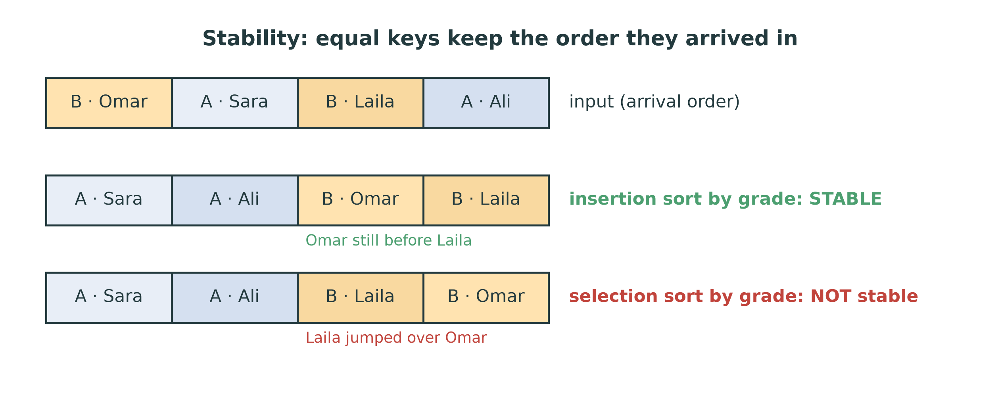{width=90%}

::: {.handout-only}

*In place*: في المكان. *Stable*: مستقر. *Key*: المفتاح — the part of an
element the sort compares.

Both words describe **how** a sort reaches the sorted order, not the order
itself. A sort of plain integers cannot show stability: two 3s look the same
whichever came first. It becomes visible only when the elements carry more than
their key — records sorted by one field. In the figure, four students are
sorted by grade. Omar arrived before Laila and both have a B. A stable sort
keeps Omar before Laila; the unstable one put Laila first. Both outputs are
sorted by grade. Only one kept the promise.

**Why it matters.** Sort a class list by name, then by grade with a stable
sort: the result is by grade, and **by name within each grade**, for free —
the same order as `ORDER BY grade, name`. Sort from the least important key to
the most important. Python's `sorted` and `list.sort` are guaranteed stable for
exactly this reason.

`dsa/sorting.py` copies your list into a course `Array`, sorts the `Array`, and
returns a new list (`test_does_not_mutate_the_input`). The rearranging itself
uses $O(1)$ extra slots in all three sorts of today, so we call them in place.
Python makes the same distinction: `values.sort()` sorts in place and returns
`None`; `sorted(values)` returns a new list.

:::

# Three O(n²) Sorts

## Bubble sort

**Idea:** compare **neighbours**; swap them when the left one is larger.

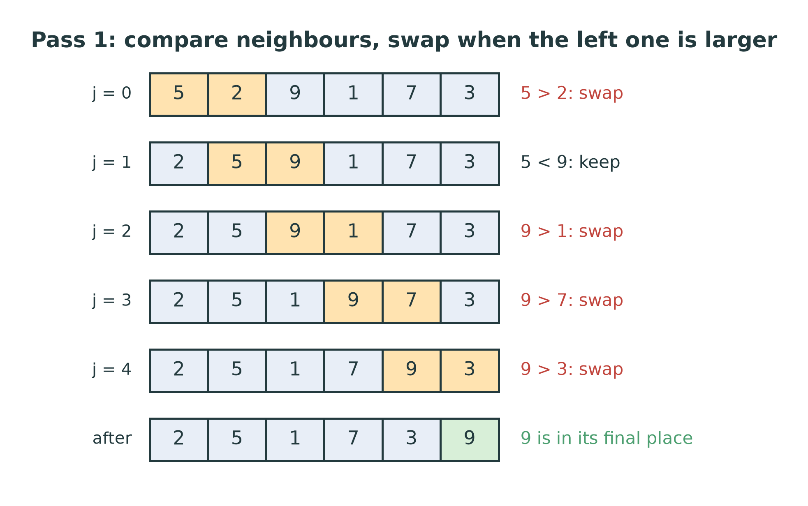{width=72%}

::: {.handout-only}

*Bubble sort*: ترتيب الفقاعات — the large values rise to the end like bubbles.

**One step** is one pass. Pass 1 on A walks the whole array, one comparison per
row. The 9 is larger than everything it meets, so it is swapped at every step
until it reaches the end. After one pass, the largest value is **in its final
place** — so the next pass can stop one slot earlier.

:::

## Bubble sort: the code

```python
def bubble_sort(a):
    n = len(a)
    for end in range(n - 1, 0, -1):      # a[end+1:] is already in place
        swapped = False
        for j in range(end):
            if a[j] > a[j + 1]:          # strictly greater: stable
                a[j], a[j + 1] = a[j + 1], a[j]
                swapped = True
        if not swapped:                  # a pass with no swap: sorted
            break
    return a
```

**Common mistake:** setting `swapped = False` once, before the loops.

::: {.handout-only}

`end` is the last slot the current pass still looks at. `swapped` records
whether this pass changed anything, so it must be reset at the start of
**every** pass: set it once, before the loops, and the first swap keeps it
`True` forever — the early exit never fires. If a whole pass swaps nothing,
every neighbour pair is in order, so the whole array is sorted: stop.

This is plain Python on a plain list, so that the algorithm is all you see.
The course version in `dsa/sorting.py` has the same loops; see "Watching your
own code" for the two things it adds.

:::

## Bubble sort, the whole run

**Predict:** how many passes does A need? Will the early exit fire?

::: {.slides-only}

. . .

:::

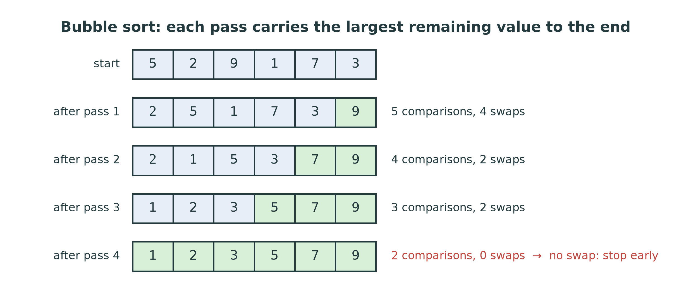{width=90%}

::: {.handout-only}

Pass k needs only $n - k$ comparisons, because the last $k - 1$ slots are
already final: 5, 4, 3, 2. Pass 4 finds nothing to swap, so the sort stops
there: **14 comparisons instead of 15**, and 8 swaps.

**Cost.** On sorted input the first pass swaps nothing: $n - 1$ comparisons,
the best case is $O(n)$. On reversed input every comparison swaps and all
$n - 1$ passes run: $n(n-1)/2$ comparisons and as many swaps, $O(n^2)$.
**Stable**, because it swaps only when `a[j] > a[j + 1]` — strictly greater —
so equal neighbours never pass each other.

:::

## Selection sort

**Idea:** find the **smallest** value of the unsorted part; swap it into the next slot.

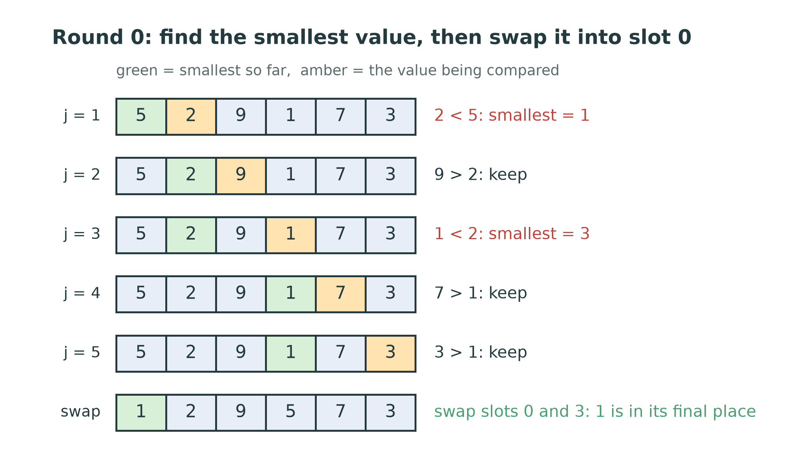{width=74%}

::: {.handout-only}

*Selection sort*: الترتيب بالاختيار.

**One step** is one round. Round 0 scans all of A and remembers where the
smallest value **so far** is (green). It changes its mind twice: at 2, then at
1. Only after the scan does it write anything — one swap, slots 0 and 3. Many
comparisons, almost no writes: that is selection sort in one picture.

:::

## Selection sort: the code

```python
def selection_sort(a):
    n = len(a)
    for i in range(n - 1):
        smallest = i
        for j in range(i + 1, n):
            if a[j] < a[smallest]:       # the best so far, not a[i]
                smallest = j
        if smallest != i:
            a[i], a[smallest] = a[smallest], a[i]
    return a
```

**Common mistake:** comparing with `a[i]` instead of `a[smallest]`.

::: {.handout-only}

Compare with `a[i]` and the scan finds the **last** value smaller than `a[i]`,
not the smallest one: on A, round 0 would pick the 3 in slot 5 instead of the 1.
The `if smallest != i` skips the swap when the minimum is already in place.

:::

## Selection sort, the whole run

**Predict:** how many swaps will A need?

::: {.slides-only}

. . .

:::

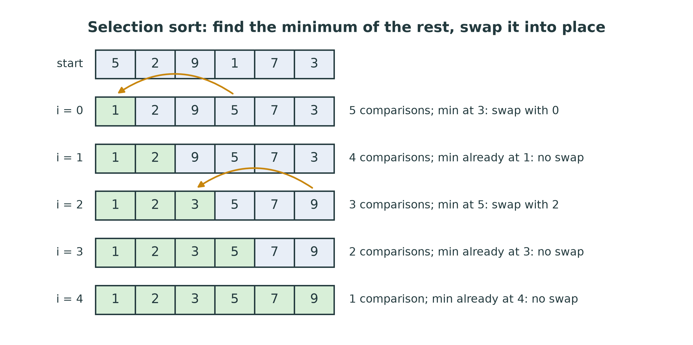{width=90%}

::: {.handout-only}

Only **2 swaps**: in rounds 1, 3 and 4 the minimum is already in place. But
every round scans the whole unsorted part, whatever the data: $5 + 4 + 3 + 2 +
1 = 15$ comparisons.

**Cost.** Always $n(n-1)/2$ comparisons — even on sorted input, so there is
**no fast best case**: $O(n^2)$ always. But at most $n - 1$ swaps, the fewest
of today's sorts. That matters when a write costs much more than a read:
moving large records, or writing to flash memory, which wears out with every
write. **Not stable:** the swap can carry a value far to the right, over an
equal one. In the stability figure, round 1 swaps Omar (B) with Ali (A), and
Omar lands behind Laila, who arrived after him.

:::

## Insertion sort

**Idea:** grow a **sorted prefix**: take the next value, shift larger values right, drop it into the hole.

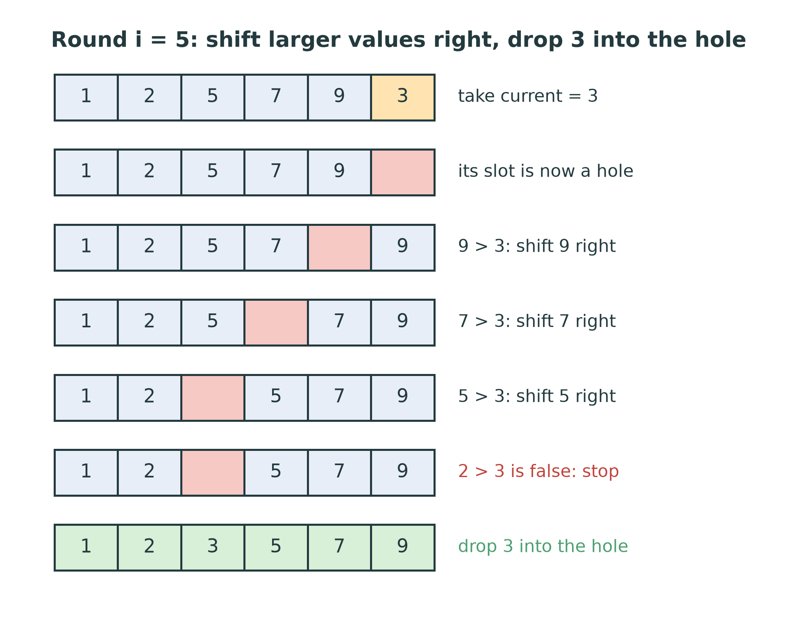{width=60%}

::: {.handout-only}

*Insertion sort*: الترتيب بالإدراج. This is how most people sort a hand of cards.

**One step** is one round. In the last round of A, `[1, 2, 5, 7, 9]` is
already sorted and `current = 3` must find its place. Its slot becomes a hole
(pink). Each larger value moves one slot right, and the hole moves one slot
left. At 2 the walk stops — 2 is not greater than 3 — and 3 drops into the
hole.

:::

## Insertion sort: the code

```python
def insertion_sort(a):
    for i in range(1, len(a)):
        current = a[i]
        j = i - 1
        while j >= 0 and a[j] > current:   # j >= 0 FIRST
            a[j + 1] = a[j]                # shift right
            j -= 1
        a[j + 1] = current                 # drop into the hole
    return a
```

**Common mistake:** `a[j] >= current` — it still sorts, but it is no longer stable.

::: {.handout-only}

**Stable**, because the walk stops at a value **equal** to `current`, so
`current` never passes an equal key. Write `>=` and the sort still sorts but
loses stability; `test_insertion_sort_is_stable` catches it.

**The order of the condition matters too.** Written the other way round,
`a[j]` is read when `j` is -1. On a Python list that silently reads the
**last** element; the course `Array` refuses negative indices and raises
`IndexError` — one more bug the `Array` catches for you.

:::

## Insertion sort, the whole run

**Predict:** in which round does nothing move?

::: {.slides-only}

. . .

:::

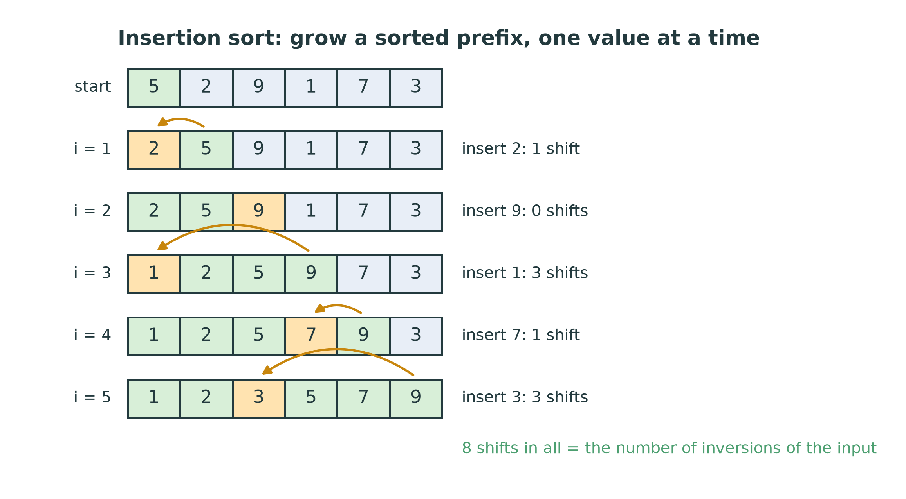{width=74%}

::: {.handout-only}

Round 2: 9 is larger than everything before it, so the walk stops after one
comparison and nothing moves. On sorted input **every** round is like this one:
$n - 1$ comparisons, no shifts, the best case $O(n)$. On A: 8 shifts and 11
comparisons, the fewest of the three sorts.

The reference `insertion_sort_steps` writes `current` into the hole after
every shift, not only at the end, so that every frame of the animation is a
real permutation of the input. That costs a second write per shift; the
comparisons are the same.

:::

## Why 8 = 8: inversions

An **inversion** is a pair $i < j$ with $a[i] > a[j]$ — a pair in the wrong order.

- A has **8**: (5,2) (5,1) (5,3) (2,1) (9,1) (9,7) (9,3) (7,3)
- Each bubble swap and each insertion shift fixes **exactly one**.
- So both make exactly **I** moves: $O(n + I)$ for insertion sort.
- Sorted: $I = 0$. Reversed: $n(n-1)/2$. Random: about $n(n-1)/4$.

::: {.handout-only}

*Inversion*: انعكاس.

When two neighbours that are out of order change places, that one pair is
fixed, and no other pair changes its order. A bubble swap does exactly that;
an insertion shift moves `current` past one larger value, which is the same
thing. So bubble sort makes exactly I swaps, insertion sort exactly I shifts,
and insertion sort runs in $O(n + I)$ time.

That one formula explains its three cases. Sorted input has no inversions:
$O(n)$. Reversed input has every pair inverted: $O(n^2)$. In a random
permutation each pair is inverted with probability ½, so the average is
$n(n-1)/4$ — still $\Theta(n^2)$, but half the worst case.

:::

# Which One, When

## The table

| | best | average | worst | A: compares · moves | stable | memory |
|---|---|---|---|---|---|---|
| bubble (early exit) | $n$ | $n^2$ | $n^2$ | 14 · 8 | yes | $O(1)$ |
| selection | $n^2$ | $n^2$ | $n^2$ | 15 · **2** | **no** | $O(1)$ |
| insertion | $n$ | $n^2$ | $n^2$ | **11** · 8 | yes | $O(1)$ |
| counting | $n + k$ | $n + k$ | $n + k$ | 0 · — | — | $O(n + k)$ |

**Choose:** few writes → selection · nearly sorted or tiny → insertion · bubble → teaching only.

::: {.handout-only}

Best, worst and average are about **inputs of the same size**: the kindest
input of size n, the cruellest, and the expected cost over all $n!$ orders.
They are three different functions of n, which is why "insertion sort is
$O(n^2)$" and "insertion sort is $O(n)$ on sorted input" are both true.

Exact comparison counts: bubble sort makes $n - 1$ at best and $n(n-1)/2$ at
worst; selection sort exactly $n(n-1)/2$ always; insertion sort between
$n - 1$ and $n(n-1)/2$, and $I + n - 1$ at most. The stability entry for
counting sort is a dash because `counting_sort` rebuilds integers from counts:
equal integers are indistinguishable, so there is nothing to keep in order.
The stable version, which moves whole records, is practice problem W9-C5.

:::

## Counting comparisons and writes

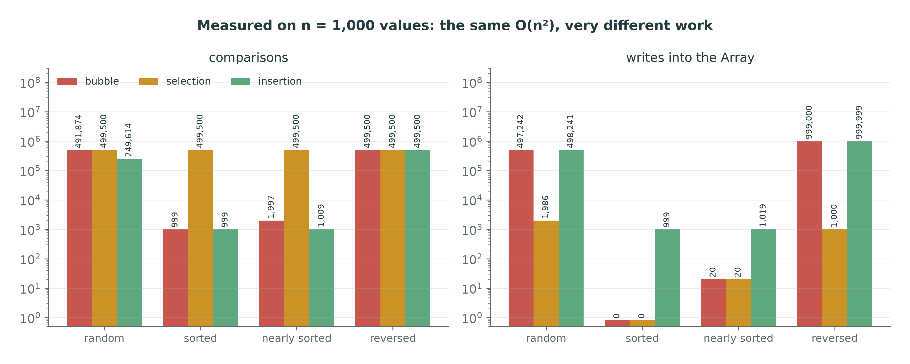{width=100%}

::: {.handout-only}

Time depends on your machine; **counts** do not. The figure counts, for
n = 1,000 values, every comparison — by sorting objects whose `<` and `>` add
1 to a counter — and every write into the course `Array`. The lab asks you to
write the comparison counter yourself.

> **Deeper — reading the counts.**
>
> - **Selection sort compares 499,500 times on every input** — $n(n-1)/2$ —
>   but writes at most 1,998 times: two writes per swap. On reversed input it
>   swaps only 500 times: each swap fixes both ends.
> - **Bubble and insertion sort** make 999 comparisons on sorted input and
>   about 1,000–2,000 on nearly sorted input (1% of neighbours swapped).
> - **Writes follow the inversions.** On the random input, with 248,621
>   inversions, bubble sort writes 2 × 248,621 = 497,242 times. Insertion sort
>   writes 498,241: two per shift in the reference, plus one final write per
>   value.
> - **Random input:** insertion sort makes about half the comparisons of
>   bubble sort (249,614 against 491,874).

:::

## Measured time

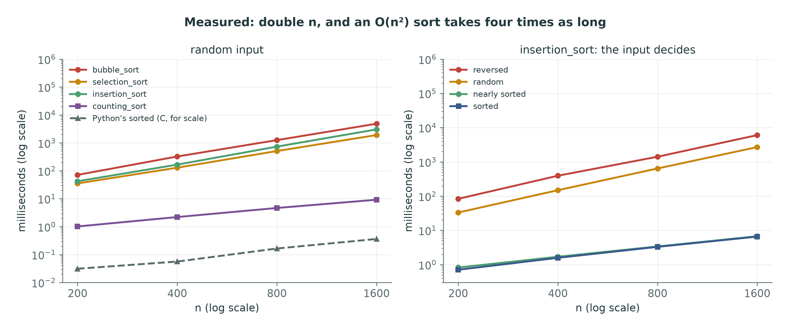{width=100%}

::: {.handout-only}

**Left: random input.** Each doubling of n multiplies the time of the three
$O(n^2)$ sorts by about four. Selection sort is the fastest of the three here,
although it compares the most: in Python a comparison is cheap next to the
reads and writes of a swap, and selection sort writes almost nothing. Counting
sort is a straight line of slope 1, $O(n)$. The dashed line is Python's
built-in `sorted`, written in C and highly optimised; the gap mixes language
and algorithm.

**Right: insertion sort on four inputs of the same size.** At n = 1,600,
reversed input took 6.0 s and random 2.7 s — half, as the inversion count
predicts — and nearly sorted input **6.7 ms**, about 400 times faster than
random. Your times will differ; look for the growth trend, not the exact
numbers.

:::

## Insertion sort on nearly sorted input

$O(n + I)$: if every value is at most **k** places from home, $I \le nk$ —
**linear** for small k.

Real sorts use it:

- **Timsort** (Python, Java): insertion sort on short runs.
- **Introsort** (C++): quicksort, then insertion sort on small pieces.

::: {.handout-only}

Data in real programs is often nearly sorted: a sorted list with a few new
records appended, a log whose timestamps are a little out of order. Insertion
sort handles these in close to linear time, with no extra memory, and it is
stable. That is why the $O(n \log n)$ sorts of next week are rarely used alone.
Python's `sorted` is **Timsort** (Tim Peters, 2002), a merge sort that first
finds the runs already in order and extends short ones with binary insertion
sort. C++'s `std::sort` is usually **introsort** (David Musser, 1997):
quicksort that switches to heap sort if the recursion goes too deep, and
finishes small pieces with insertion sort. The "slow" sort of today is inside
the fast sorts of the real world.

> **Deeper — why $I \le nk$.** If every element is at most k places from its
> final position, an inverted pair cannot start more than 2k positions apart.
> So there are $O(nk)$ inversions and insertion sort costs $O(n + nk)$: linear
> when k is a small constant. See practice W9-C4.

:::

# Beyond Comparisons

## Counting sort

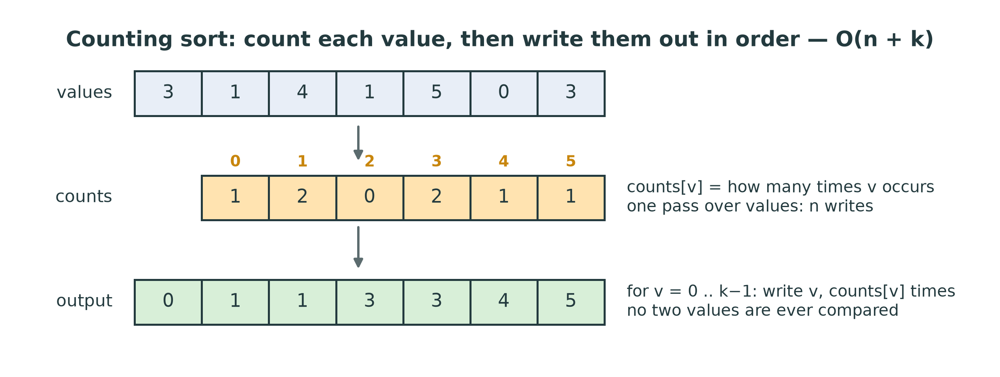{width=92%}

**Idea:** the values are small integers, below k — **count** them, then write each value out as many times as it was counted. $O(n + k)$.

::: {.handout-only}

*Counting sort*: الترتيب بالعد.

The value **is** the index — that is the whole trick. For
`[3, 1, 4, 1, 5, 0, 3]`, k = 6: one counter for each possible value 0 .. 5.
One pass over the values fills the counters `[1, 2, 0, 2, 1, 1]`; one pass
over the counters writes the output. k counts the **possible** keys, not only
the ones that occur: the 2 has a counter, with nothing in it.

**The catch is k.** Sorting a hundred exam marks out of 100 is quick; sorting
ten phone numbers needs ten billion counters. Counting sort is fast exactly
when the **range** of the values is not much larger than their **number**. It
also needs keys that can be used as indices: non-negative integers, or things
that map to them (letters, grades, ages). The reference raises `ValueError`
for anything else.

:::

## Counting sort: the code

```python
def counting_sort(a):
    if not a:                            # max([]) would fail
        return []
    counts = [0] * (max(a) + 1)          # k = max + 1 counters
    for v in a:
        counts[v] += 1                   # the value IS the index
    result = []
    for v in range(len(counts)):
        for _ in range(counts[v]):       # write v, counts[v] times
            result.append(v)
    return result
```

**Predict:** what does `counting_sort([0, 1000000000])` cost?

::: {.handout-only}

Time: one pass over the n values, one over the k counters, and n writes —
$O(n + k)$. Extra space: $O(n + k)$, so it is **not** in place. For
`[0, 1000000000]`, only two values are present, but the code allocates
1,000,000,001 counters and then reads every one: the k term is the whole cost.

This version uses Python lists and does not check its input. The course
version uses a course `Array` for the counters, accepts a `max_value`, and
raises `ValueError` for a negative or non-integer value.

:::

## Worst case: comparison sorting needs $\Omega(n \log n)$

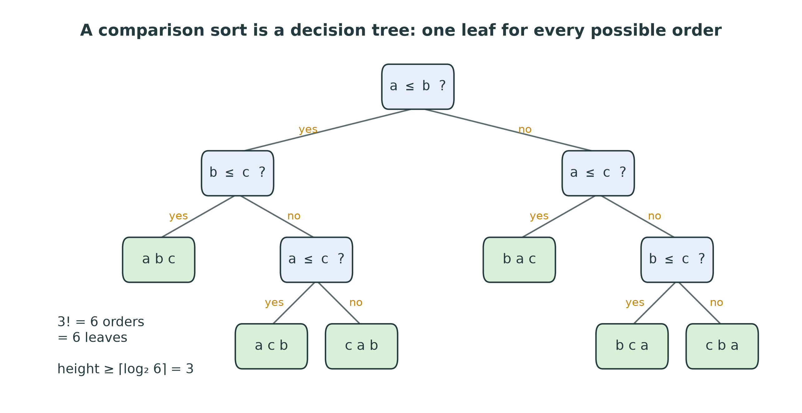{width=80%}

n **distinct** values have **n!** orders, and the sort must tell them all apart.
Each comparison has 2 outcomes, so the worst case needs at least
$\log_2 n! \approx n \log_2 n$ comparisons.

::: {.handout-only}

*Lower bound*: الحد الأدنى. *Decision tree*: شجرة القرار.

Take any sort that learns about its input **only** by comparing two elements.
Draw every comparison it might make as a node, with two branches for the two
answers: that is its **decision tree**. The figure is insertion sort's tree
for three values. A run is a path from the root to a leaf, and its length is
the number of comparisons. Each leaf must correspond to **one** order of the
input — if two orders reached the same leaf, the sort would do the same moves
on both and get one of them wrong. So the tree needs at least $n!$ leaves, and
a binary tree of height h has at most $2^h$: $h \ge \log_2 n!$.

For 3 values, $\log_2 6 \approx 2.6$: at least **3** comparisons in the worst
case, and the tree achieves it. For a thousand values, about 8,530 — against
499,500 for today's sorts. Week 10's merge sort and heap sort reach this floor.
The bound is about the **worst** case: bubble and insertion sort still make
only $n - 1$ comparisons on sorted input.

> **Deeper — why $\log_2 n! = \Theta(n \log n)$.** Half the factors of $n!$
> are at least $n/2$, so $n! \ge (n/2)^{n/2}$ and
> $\log_2 n! \ge \frac{n}{2} \log_2 \frac{n}{2}$. In the other direction,
> $n! \le n^n$, so $\log_2 n! \le n \log_2 n$. (The same tree also bounds the
> average case — a stronger result, beyond this course.)

:::

## How counting sort escapes

The lower bound assumes the sort learns **only by comparing**.

Counting sort never compares two keys: `counts[v] += 1` uses the value **as an
address** — one step with k possible outcomes, not 2.

::: {.handout-only}

The lower bound is not a law about sorting; it is a law about **comparison**
sorting. Counting sort gets more information per step because it assumes more
about the data — small integer keys — and pays for it with $O(k)$ memory and
the restriction on the keys. (The `max` call may compare values; "not
comparison-based" describes how the order is obtained.)

Radix sort (not examined in this course) pushes the same idea further: it
sorts large integers digit by digit, with a **stable** counting sort per digit,
in $O(d(n + b))$ time for d digits in base b. That is why the stable version of
counting sort matters, and why W9-C5 asks you to write it.

:::

# This Week

## Watching your own code

`dsa/sorting.py` = the same loops + a copy into an `Array` + `yield` lines:

```python
        for j in range(end):
            yield list(a), (j, j + 1)    # one frame: a copy, and the pair
            if a[j] > a[j + 1]:
```

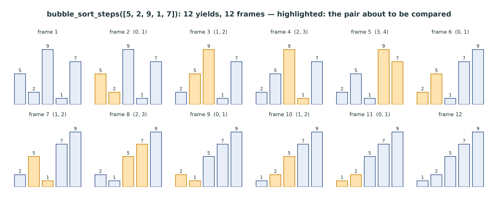{width=80%}

::: {.handout-only}

Each sort in `dsa/sorting.py` has a second form, `bubble_sort_steps` and so on:
the code of this lecture with `yield` lines added — one at the start, one before
each comparison, one at the end. A generator (Lab 03, "Generators") runs only
as far as it is asked to, so the notebook draws one frame per `yield` and you
step through **your own** code. The plain `bubble_sort` runs the generator to
its end and returns the last state, so there is only one copy of the loops to
keep correct. The figure shows all 12 frames of `bubble_sort_steps([5, 2, 9, 1, 7])`.

Two rules, and the tests check both: yield `list(a)`, a fresh copy, so that
each frame is its own list (`test_step_frames_are_independent_snapshots`); and
yield once more after the loops, so that the last frame is sorted
(`test_step_form_is_a_generator_ending_sorted`).

> **Deeper — the price of watching.** A copy costs $O(n)$. Made before each of
> about $n^2/2$ comparisons, it turns an $O(n^2)$ sort into $O(n^3)$: the time
> grows 8 times per doubling of n instead of 4. The fix keeps one
> implementation: each `_steps` function takes a `snapshot` parameter, `list`
> by default for the animation, and the plain sort passes `_live`, which
> returns the working `Array` without a copy. Lab 09 Parts 1 and 7 walk you
> through the pattern, the measurement and the fix. The lesson is wider than
> sorting: **instrumenting code changes its cost** — a print, a log line or an
> `is_sorted` check inside a loop can hide an $O(n)$ inside your $O(n^2)$.

:::

## Exercises, and the Sorting Lab

| Function | The trap |
|---|---|
| `bubble_sort_steps` | yield `list(a)`, not `a`; reset `swapped` each pass |
| `selection_sort_steps` | compare with `a[smallest]`, not `a[i]` |
| `insertion_sort_steps` | `j >= 0` **first**; `>` not `>=` |
| `counting_sort` | `k = max + 1`; the empty list |

```powershell
pytest tests/test_sorting.py -v `
    -k "bubble or selection or insertion or counting or is_sorted"
```

[**Sorting Lab**](https://helghareeb.github.io/DSA27/lectures/09-sorting-basic/sorting-lab.html): today's four sorts, line by line, on A or on your own list.

::: {.handout-only}

Thirty-nine tests (`is_sorted` is given, and its one test already passes).
Every sort is held to the same contract: eight fixed cases (empty, one value,
two, duplicates, sorted, reversed, negatives), twenty random lists, "does not
mutate the input", and the two tests on the `_steps` form. Merge, quick and
heap sort share the file and are Week 10's — the `-k` filter leaves them out.
Start from the code on the slides and add the `yield` lines. Store the working
copy in a course `Array` (`Array.from_values(values)`); return a list. Do not
call `sorted`, `list.sort` or `min` inside `dsa/sorting.py`.

**The Sorting Lab** runs the code of this lecture, one line at a time: the bars,
the variables, the comparisons and the swaps, the inversions still left. Try
the presets — sorted, reversed, nearly sorted — and watch the counters; switch
on **What happens next?** to answer before each step; and use the **cards**
input to watch selection sort break a tie.

- **Online:** <https://helghareeb.github.io/DSA27/lectures/09-sorting-basic/sorting-lab.html>
- **Offline:** open `docs/lectures/09-sorting-basic/sorting-lab.html` from your
  copy of the repository. It is a single file and needs no installation.

:::

## Homework 9 — before Lecture 10

1. **Implement** the four sorts until the 39 tests pass.
2. **Trace** each of the three sorts on `[4, 1, 3, 9, 7, 2]`, one row per
   pass or round, counting comparisons and swaps or shifts.
3. **Count.** Write a class whose `<` and `>` count, sort 1,000 of them
   sorted, reversed and random, and compare with the figure.
4. **Break it.** Change `>` to `>=` in your insertion sort. Which tests fail?
   Now sort `[(1, 'a'), (1, 'b')]` — why can a list of tuples not show the bug?

Then: the [**Week 9 quiz**](https://helghareeb.github.io/en/quizzes/dsa27/week-09/) — 22 questions and 5 written ones, every answer explained ([Arabic](https://helghareeb.github.io/ar/quizzes/dsa27/week-09/)).

::: {.handout-only}

For item 3, the class needs `__init__`, `__lt__` and `__gt__` (Lab 03,
"Special methods"), and a counter they share — a class attribute. The lab walks
you through it.

For item 4, look at how tuples compare: `(1, 'a') < (1, 'b')` is `True`. Two
tuples that are "equal by their first item" are not equal to Python, so the
sort orders them by their second item — which happens to be their arrival
order. `test_insertion_sort_is_stable` uses cards that compare by key **only**
for exactly this reason.

Do the quiz **after** the homework, as a check, not instead of it. Everything
runs in the browser and keeps your results on your own device.

:::

## Seven things to keep

1. Sorting makes Week 8's searches possible — **its cost decides** whether
   sort-then-search pays.
2. **Stable:** equal keys keep their order. Bubble and insertion are; selection
   is not.
3. Bubble and insertion: **$O(n)$ best, $O(n^2)$ worst**. Selection:
   $n(n-1)/2$ comparisons always, but at most $n - 1$ swaps.
4. Each bubble swap and each insertion shift fixes **one inversion**:
   $O(n + I)$ — near-linear on nearly sorted data, which is why real sorts use it.
5. A copy per animation frame turns $O(n^2)$ into **$O(n^3)$** — watching costs.
6. Counting sort: $O(n + k)$, **no comparisons** — fast only when k is small.
7. Every comparison sort needs **$\log_2 n! = \Theta(n \log n)$** comparisons
   in the worst case.

**Next — Week 10:** merge sort, quicksort and heap sort reach the $n \log n$ floor.

::: {.handout-only}

---

## Sources and further reading

- **D. E. Knuth.** *The Art of Computer Programming*, vol. 3, *Sorting and
  Searching*, 2nd ed., Addison-Wesley, 1998, §5.1.1 (inversions), §5.2.1
  (insertion sort), §5.2.2 (bubble sort), §5.2.3 (selection sort), §5.3.1
  (the comparison lower bound).
- **T. H. Cormen, C. E. Leiserson, R. L. Rivest and C. Stein.** *Introduction to
  Algorithms*, 4th ed., MIT Press, 2022, §2.1 (insertion sort), §8.1 (lower
  bounds for sorting), §8.2 (counting sort).
- **O. Astrachan.** "Bubble Sort: An Archaeological Algorithmic Analysis",
  *SIGCSE Bulletin* 35(1), 2003 — where the name and the algorithm came from,
  and why it survives in teaching.
- **T. Peters.** "listsort.txt", in the CPython source tree — the design of
  Timsort, including its use of binary insertion sort on short runs.
- **D. R. Musser.** "Introspective Sorting and Selection Algorithms",
  *Software: Practice and Experience* 27(8), 1997.
- **Python documentation.** "Sorting Techniques" (the Sorting HOW TO) — stability
  and sorting by several keys.

Every figure in this lecture is generated by `tools/figures_l09.py`. The
diagrams are traces computed and checked by the script; the counts and timings
are measured on the reference `dsa/sorting.py`, and your timings will differ.

:::
